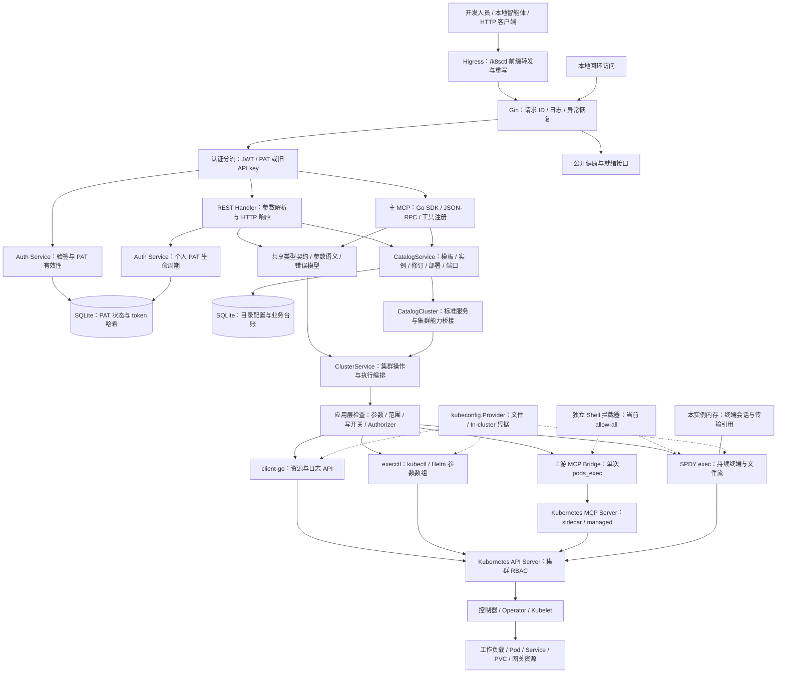
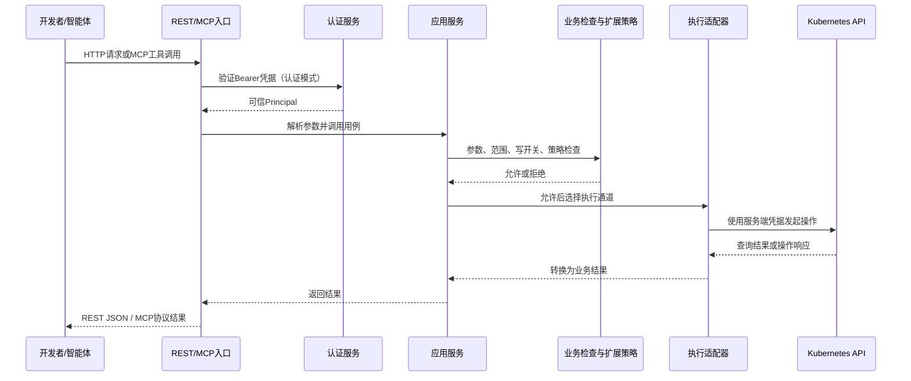
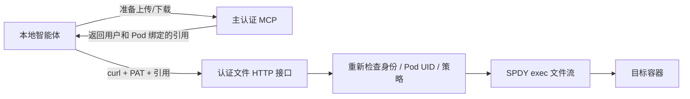
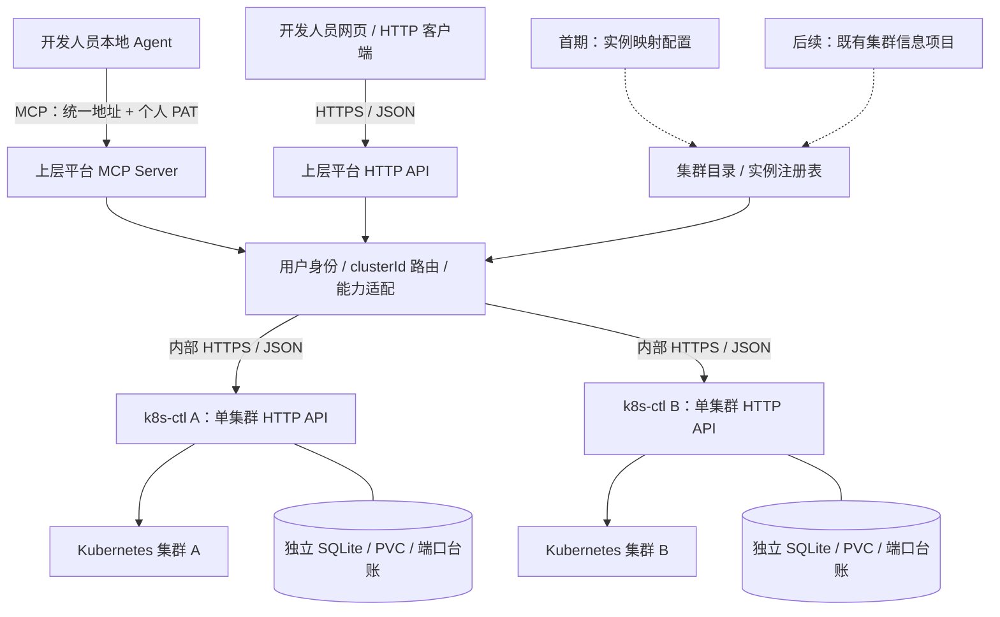
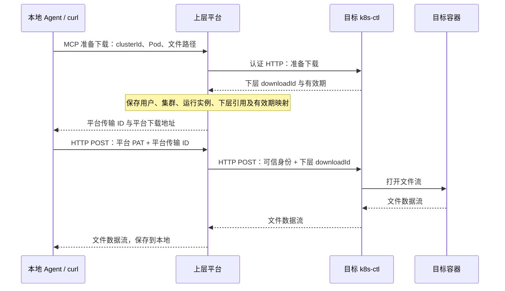

# olixops-k8s-ctl

`olixops-k8s-ctl` 是一个面向受控 Kubernetes 集群的控制服务。它把 Kubernetes 查询、清单校验、常用工作负载操作和 Helm 操作封装成 HTTP API 与 MCP 工具，服务默认监听本机回环地址，并通过固定的集群、Namespace、资源类型和参数边界降低误操作风险。

当前版本已支持 **公司 RS256 JWT 与个人 PAT 认证**，REST 和 MCP 共用认证链路；PAT 支持个人创建、列表、撤销、到期与数据库有效性校验。认证为显式迁移开关：仓库示例仍为 `auth.enabled: false`，需准备密钥后开启，完整步骤见 [认证接入说明](docs/authentication.md)。开启认证时 MCP 使用 `/api/v1/mcp`，旧公开入口不注册。**资源级细粒度授权、审批和完整审计仍未实现**，Authorizer 仍默认放行；原有写开关、资源范围与 Kubernetes RBAC 继续生效。

## 当前功能清单

以下按当前仓库代码整理（2026-11-06），用于查找功能与阅读源码；不代表线上镜像已更新，也不代表所有服务都完成了真实集群验收。产品定位是 **Dev Ready：面向开发人员的开发环境自助平台**。自然语言理解由外部智能体承担，k8s-ctl 提供固定的 MCP 工具、HTTP 接口和部署执行能力，服务端不内置大模型。

### 已实现的业务能力

认证补充（2026-11-06）：支持公司 JWT 验签、可信用户 context、个人 PAT 签发/列表/撤销、SQLite 有效状态检查、每用户 10 个有效 PAT 限额，以及本地管理员离线签发首个 PAT。配置与接口见 [JWT/PAT 认证](docs/authentication.md)。

| 模块 | 当前可用功能 | 主要源码入口 |
| --- | --- | --- |
| 集群与基础资源查询 | 查询集群版本、可见 Namespace、StorageClass、Namespace 下工作负载/Pod/Service/PVC 摘要、Gateway API 资源摘要 | [cluster_service.go](internal/application/cluster_service.go) |
| 通用资源读取 | 按类型和名称读取资源详情，按 label 筛选与分页列举资源；读取白名单资源的原始 YAML，Namespace YAML 也可通过专用读取分支查询 | [operations.go](internal/infrastructure/kubernetes/operations.go) |
| YAML 校验与部署 | 本地检查 YAML 结构、资源类型和 Namespace 范围；服务端 dry-run；通过 kubectl apply 创建或更新白名单资源，支持多文档清单 | [manifest.go](internal/application/manifest.go)、[operations.go](internal/application/operations.go) |
| Namespace 管理 | 列表、创建、删除；增改 labels/annotations，显式删除指定元数据键；元数据接口不允许修改其他关键字段；保护 `default`、`kube-*` 不被删除 | [operations.go](internal/application/operations.go) |
| 工作负载操作 | Deployment/StatefulSet 扩缩容（含缩到 0）；Deployment/StatefulSet/DaemonSet 重启、指定修订回滚、rollout 状态快照和历史修订查询 | [operations.go](internal/application/operations.go)、[history.go](internal/infrastructure/kubernetes/history.go) |
| Pod、事件与排障 | Pod 详情与 YAML、单 Pod 删除；查询容器日志，支持尾部行数、时间范围、上一容器和时间戳；按资源筛选事件并分页 | [operations.go](internal/infrastructure/kubernetes/operations.go) |
| ConfigMap 与通用删除 | 合并更新已有 ConfigMap 的 data；按名称删除单个白名单资源，使用 UID 前置条件避免误删同名替换对象 | [operations.go](internal/infrastructure/kubernetes/operations.go) |
| Helm 管理 | release 列表、状态和历史；安装/升级、指定版本回滚、卸载；执行前下载/渲染并检查资源范围，禁用 hooks | [helm.go](internal/infrastructure/execctl/helm.go) |
| 标准服务发现与快捷部署 | 发现七类服务、别名、推荐模板和环境默认值；指定 Namespace 后使用默认规格完成配置保存、端口领用和部署，返回实例/部署 ID、内部地址和可用的外部地址 | [standard.go](internal/application/catalog/standard.go) |
| 模板与实例配置中心 | SQLite 内置存储，无需单独部署数据库；模板列表/详情、新增不可变模板版本；创建独立实例、保存配置修订、预览 YAML、查询实例和原始历史修订；保存配置本身不部署、不占端口 | [templates.go](internal/application/catalog/templates.go)、[service.go](internal/application/catalog/service.go) |
| 部署记录与恢复 | 准备部署时冻结配置修订、YAML 与摘要；保存部署阶段、历史、资源清单和观测结果；相同 requestId/参数重放恢复原流程，参数冲突拒绝；实例与入口操作使用进程内锁 | [deployments.go](internal/application/catalog/deployments.go) |
| Higress 共享端口管理 | 管理固定共享 LB 的 TCP 端口池，默认 `30000–30200`（包含两端，共 201 个）；读取实际 Service/Gateway/TCPRoute 后同步台账、识别外部占用与冲突；自动或指定端口预留、绑定、释放及历史事件查询 | [ports.go](internal/application/catalog/ports.go)、[catalog_cluster.go](internal/application/catalog_cluster.go) |
| 标准实例访问验证 | 经外部 LB 端口执行 Redis PING、PostgreSQL SELECT 1、MySQL/MongoDB Ping、Milvus 只读集合查询或 Nginx/Jupyter HTTP 检查；返回协议验证结果 | [catalog_verify.go](internal/infrastructure/kubernetes/catalog_verify.go) |
| 实例删除与回收 | 根据记录的资源 UID 清理实例，确认路由移除后释放端口；数据库实例默认保留 PVC，保留共享 Namespace 和入口；异常时保留记录与端口供查询和重试 | [deployments.go](internal/application/catalog/deployments.go) |
| Python 沙箱租期 | JupyterLab 浏览器开发环境；默认 2 小时，可设 60–86400 秒；启动和每分钟扫描过期实例，按正常删除流程回收，失败后继续重试；支持预装 RuntimeClass | [standard.go](internal/application/catalog/standard.go)、[main.go](cmd/main.go) |

Pod/Deployment 等白名单资源的创建和一般更新走通用 YAML apply，并不是每个资源都有独立 CRUD 工具。ConfigMap 和 Namespace 元数据另有专用更新工具。Secret 通用 CRUD 未开放；标准模板可按支持情况引用已有 Secret。

### 标准服务覆盖范围

| 服务 | 常用别名 | 工作负载与存储 | 后端端口 | 当前用途 |
| --- | --- | --- | --- | --- |
| Redis | `redis` | StatefulSet + 独立 PVC | 6379 | 独立开发缓存 |
| PostgreSQL | `postgres`、`postgresql`、`pg` | StatefulSet + 独立 PVC | 5432 | 独立开发数据库 |
| MySQL | `mysql` | StatefulSet + 独立 PVC | 3306 | 独立开发数据库 |
| MongoDB | `mongodb`、`mongo` | StatefulSet + 独立 PVC | 27017 | 独立开发文档数据库 |
| Milvus Standalone | `milvus` | StatefulSet + 独立 PVC | 19530 | 单机开发向量数据库 |
| Nginx | `nginx` | Deployment，无 PVC | 80 | HTTP demo，可配置首页内容 |
| Python JupyterLab | `sandbox`、`python`、`jupyter`、`jupyterlab`、`沙箱` 等 | Deployment，临时存储 | 8888 | 浏览器 Python 环境，支持 TTL 回收 |

这些端口是服务容器的后端端口；对外端口从共享 Higress 端口池分配，两者不同。各实例保存独立配置和资源标识；ownerId 只是归属记录，目前没有基于用户身份的所有权隔离。镜像、资源规格、数据库初始化方式和凭据参数见 [常用服务使用说明](docs/standard-service-quickstart.md)。

### 接口与运行支撑

| 能力 | 当前实现 |
| --- | --- |
| MCP 接入 | 官方 Go SDK，stateless Streamable HTTP；认证入口 `/api/v1/mcp`（旧兼容模式 `/api/v1/pub/mcp`），目录、exec、Shell 与写工具全部开启时共 **57 个工具**（未开启 exec/Shell 时原业务工具为 50 个）；完整名称见下方「MCP 能力」及使用指南 |
| REST 接入 | `/api/v1/pub` 提供健康/就绪检查，`/api/v1/cluster` 覆盖资源、工作负载、Helm、日志、Shell、终端与文件；`/api/v1/templates`、`/services`、`/ports` 提供目录操作；**57 个 MCP 业务工具均有 HTTP 对应入口**，另有文件流与实例能力查询 |
| 操作器接入 | `http.enabled` 默认开启；可关闭主 MCP，通过认证 HTTP 独立执行。`/api/v1/operator/capabilities` 返回 clusterId、runtimeId 和实际能力；详见 [操作器指南](docs/http-operator-guide.md) |
| 连接集群 | 本地 kubeconfig 文件和 InCluster ServiceAccount 两种可用 Provider，当前只控制服务配置的一个集群 |
| 功能边界 | Namespace 范围、固定资源类型、参数与大小限制、超时、MCP 写工具注册开关、Kubernetes 写操作开关；所有操作保留 Authorizer 扩展点 |
| 日志与错误 | `pkg/logger`、请求 ID 透传/回写、统一 REST 响应；MCP 使用标准协议结果；目录业务错误提供 reason，端口事件与部署阶段持久化 |
| 部署交付 | Dockerfile、容器配置、ConfigMap/Secret 文件挂载、单副本 SQLite PVC、ServiceAccount/RBAC 示例、Higress `/k8sctl` 前缀 Ingress；配置修改后需重启 |
| 自动化验证 | 模拟 Kubernetes API、CLI 子进程、SQLite 与本地协议端点测试，覆盖 HTTP/MCP 契约、资源边界、幂等、端口并发、失败恢复、UID 删除和沙箱回收 |

### 预留或尚未实现的能力

- **资源权限**：JWT/PAT 认证与个人令牌归属已实现；专用诊断入口已支持精确用户 grant；其他资源的细粒度授权、按用户隔离、审批和完整审计尚未实现，默认 Authorizer 放行。平台没有本地密码登录，需公司 JWT 或管理员离线 PAT 引导。
- **多集群与凭据中心**：没有多集群注册/切换；数据库 kubeconfig Provider 只有适配接口，尚未接入加密持久化与轮换实现。
- **高可用与恢复**：SQLite 和进程内锁按单副本协调器设计；没有多副本部署协调、集群自动修复、数据库备份恢复或通用事务回滚。
- **Operator 与通用资源范围**：已有 Redis Operator 演示清单和测试记录，但标准目录尚未接入 Operator；任意 CRD/自定义资源、Secret CRUD、RBAC 管理、节点操作尚未开放；Pod exec、持续终端和文件传输已有显式启用的受控入口。
- **完整配置中心与交互界面**：目前保存标准服务模板及实例配置，不是任意应用配置的分发/订阅中心；没有开发者自助 Web 门户，也没有仓库内的项目专用 Skill 文件。
- **持续状态与网络自动化**：没有 watch/实时日志、通用操作任务中心，也不自动申请外部网络权限；平台侧协议检查不能证明用户网络可达。现有端口池不表示所有端口都已暴露或空闲。
- **验收边界**：七类模板及流程已有自动化覆盖，但不能据此认定七类镜像均已在目标集群成功运行。`applied`、Kubernetes `ready`、服务端协议验证和用户侧访问是不同验收阶段。

更详细的限制见下方「资源与写操作边界」「已知遗漏和风险」。当前 PoC 模板有无认证数据库和沙箱默认配置，具体见使用说明，不能作为生产安全配置。

## 先看什么

建议按下面顺序阅读源码：

1. [cmd/main.go](cmd/main.go)：启动、配置、kubeconfig Provider、client-go、命令 Runner 和路由的组装。
2. [internal/interfaces/router/router.go](internal/interfaces/router/router.go)：公开健康接口、REST 控制接口和 MCP 入口。
3. [internal/interfaces/handler/cluster.go](internal/interfaces/handler/cluster.go)：REST 请求绑定和统一响应。
4. [internal/interfaces/mcp/server.go](internal/interfaces/mcp/server.go)、[internal/interfaces/mcp/operations.go](internal/interfaces/mcp/operations.go)：MCP 工具注册、超时、结果和工具到用例的映射。
5. [internal/application/cluster_service.go](internal/application/cluster_service.go)、[internal/application/operations.go](internal/application/operations.go)：Namespace、资源、清单和写操作的业务边界。
6. [internal/domain/resources.go](internal/domain/resources.go)、[internal/domain/authorization.go](internal/domain/authorization.go)：资源白名单与权限扩展点。
7. [internal/infrastructure/kubernetes](internal/infrastructure/kubernetes)：client-go 查询、动态资源、事件、日志、扩缩容和状态适配器。
8. [internal/infrastructure/execctl](internal/infrastructure/execctl)：以参数数组调用 kubectl/Helm 的适配器。
9. [internal/infrastructure/kubeconfig](internal/infrastructure/kubeconfig)：文件、数据库接口和 InCluster kubeconfig Provider。
10. [internal/application/catalog](internal/application/catalog)、[internal/domain/catalog](internal/domain/catalog)、[internal/infrastructure/catalogdb](internal/infrastructure/catalogdb)：SQLite 标准模板、独立实例配置、不可变修订、Higress 端口与部署状态机。
11. [tests](tests)：从 Gin/MCP 到模拟 Kubernetes API、命令子进程和权限拒绝适配器的契约测试。

标准服务从配置保存到部署、回收的源码路径与完整参数见 [标准服务目录文档](docs/standard-services.md)。MCP 的完整参数、限制和调用示例见 [docs/mcp-development.md](docs/mcp-development.md)；权限控制的后续设计见 [docs/mcp-authorization-design.md](docs/mcp-authorization-design.md)。

认证与个人令牌生命周期见 [认证接入说明](docs/authentication.md)。以下公开 MCP/API key 描述适用于 `auth.enabled=false` 的兼容模式；开启后业务路由要求 JWT/PAT，MCP 路径改为 `/api/v1/mcp`。

PoC 使用方的服务地址、接入方式、默认 50 个工具清单（本次代码版本）与调用示例见 [MCP 使用指南](docs/mcp-user-guide.md)。

## 整体架构与请求链路

以下说明基于当前工作区实现，包含认证、主 MCP、标准服务目录、持续终端及文件上传下载；不代表已部署镜像与代码同步，也不表示所有链路都完成真实集群验收。

项目是一个 **分层 Go 单体控制服务**：REST 与主 MCP 共用应用服务，应用服务通过多个适配器操作 Kubernetes，SQLite 保存平台配置与台账。自然语言理解由外部智能体承担；服务端没有内置大模型，也没有把所有集群操作转交上游 MCP。

### 当前单实例运行架构图



图中的“应用层检查”概括业务方法内部的检查位置，不是独立部署的网关。箭头表示主要运行调用与数据关系，不代表所有包的静态依赖。sidecar 是同 Pod 的辅助容器，不意味着采用 Istio。

### 入站规则

| 层次 | 当前规则 | 作用与边界 |
| --- | --- | --- |
| Higress | 外部 `/k8sctl/...` 去掉前缀后转发到服务 | 本地访问可以直接进入 Gin；应用路由不重复添加此前缀 |
| 全局中间件 | Request ID、访问日志、异常恢复 | 使用 `pkg/logger`；响应回写 `X-Request-Id` |
| 公开路由 | `/api/v1/pub/health`、`/api/v1/pub/ready` | 无需业务认证的健康与就绪检查 |
| 认证模式 | `Authorization: Bearer ...`，主 MCP 为 `/api/v1/mcp` | JWT 验签；PAT 额外查询数据库有效性；身份写入 context |
| 旧兼容模式 | `auth.enabled=false` 时，受保护 REST 使用 ControlKey，MCP 可位于 `/api/v1/pub/mcp` | 不是 JWT/PAT 的资源隔离方案；开放情况仍受配置限制 |
| 接口适配 | REST 解析请求；MCP 校验工具输入并映射业务方法 | REST 通常返回 `{code,msg,data}`，MCP 使用标准 JSON-RPC；下载成功返回二进制流 |
| 工具注册 | 根据 MCP、写开关、Catalog、Pod Exec、Shell、diagnostics-only 配置决定工具集合 | 工具可见性是功能开关，不等于逐用户资源授权 |
| 业务检查 | 参数、Namespace、资源类型、写操作开关和 Authorizer | REST 与 MCP 复用业务约束；认证模式下只读业务请求也需要有效身份 |
| 容器操作 | 额外校验目标、Pod UID、已有 grants、会话或传输引用归属及拦截器 | 用户身份来自可信 context，不接受调用方自报 user-id 作为身份 |
| 集群侧 | 服务端 kubeconfig / ServiceAccount 身份接受 Kubernetes RBAC 校验 | 客户端不持有 Kubernetes 凭据；平台身份认证不能替代集群 RBAC |

REST 无参数查询使用 GET，带参数业务操作使用 POST，不使用 DELETE/PUT 作为业务接口。REST 与 MCP 的功能覆盖不完全相同，不能将工具名直接视为对应的 HTTP URL。

### 请求处理顺序



拒绝时流程在相应检查处结束，不继续执行后续步骤。容器操作还会调用集中 Shell 拦截扩展点；图中没有展开这些用例特有的检查。

Kubernetes 接受写入不表示应用已经就绪：创建资源后仍需控制器或 Operator 调谐，分别检查 `applied`、运行就绪、服务端协议验证和用户侧实际可达性。超时或提交期间断连也不等于没有产生副作用，结果不确定时应先回读状态。

### 模块关系与分层

| 层次 / 模块 | 主要责任 | 依赖关系与源码入口 |
| --- | --- | --- |
| 启动与组装 | 加载 Viper 配置，创建认证、Provider、客户端、Runner、业务服务和路由 | [cmd/main.go](cmd/main.go) 是依赖组装入口 |
| interfaces | 路由、中间件、REST handler、主 MCP 的协议转换与功能注册 | [router](internal/interfaces/router/router.go)、[handler](internal/interfaces/handler)、[mcp](internal/interfaces/mcp/server.go) 调用应用层 |
| application / ClusterService | 资源、清单、Helm、日志、容器操作和业务范围检查 | [cluster_service.go](internal/application/cluster_service.go)、[operations.go](internal/application/operations.go) 调用执行适配器 |
| application / CatalogService | 模板、实例、不可变配置修订、端口和部署状态机 | [catalog/service.go](internal/application/catalog/service.go) 使用 Repository 与 Cluster 接口 |
| CatalogCluster 桥接 | 让标准服务复用现有集群能力和边界，不另造执行链路 | [catalog_cluster.go](internal/application/catalog_cluster.go) 调用 ClusterService 及集群适配能力 |
| application / Auth Service | 认证和个人 PAT 生命周期 | [auth/service.go](internal/application/auth/service.go) 使用 Verifier、Issuer、Repository |
| domain | 资源模型、业务状态、授权请求和接口契约 | [domain](internal/domain)；Authorizer 是后续权限策略的统一接入点 |
| infrastructure | Kubernetes API、CLI、上游 MCP、凭据、SQLite 与 JWT 的具体实现 | [infrastructure](internal/infrastructure) 承接外部 I/O |
| 公共支撑 | 日志、请求标识与响应结构 | [pkg/logger](pkg/logger)、[pkg/response](pkg/response) |

这是按分层思想组织的单体项目，并非完全解耦的纯净架构：ClusterService 仍直接持有具体 Kubernetes Client 和 Runner。新增功能应继续沿用既有应用入口与 adapter，避免在 handler 或 MCP 工具中直接堆叠集群操作。

### 四条 Kubernetes 执行通道

| 通道 | 用途 | 实现与凭据关系 |
| --- | --- | --- |
| client-go Adapter | 查询、部分资源变更、日志等 | [kubernetes](internal/infrastructure/kubernetes)，通过 Provider 创建客户端 |
| kubectl / Helm Runner | YAML apply、Helm 安装升级及相关操作 | [execctl](internal/infrastructure/execctl)，参数数组调用，不拼接用户 shell 命令 |
| 上游 Kubernetes MCP Server | 单次 `pods_exec`，含显式启用的 Shell 动作 | [k8smcp](internal/infrastructure/k8smcp)，集群 sidecar 或本地 managed 模式；managed 使用同一 Provider 快照，sidecar 使用同集群 In-cluster 身份 |
| client-go SPDY exec | 持续 stdin/TTY 与二进制文件流 | [stream.go](internal/infrastructure/kubernetes/stream.go)，与目标检查共用 Provider-backed 客户端，不经过上游单次文本 pods_exec |

`kubeconfig.Provider` 是凭据读取边界；client-go、CLI、managed 上游连接须指向同一选定集群。当前可用来源是本地文件与 In-cluster ServiceAccount；数据库来源仍是预留接口，没有实现凭据中心的加密存储与轮换。业务接口不返回 kubeconfig。

### 标准服务部署与端口台账

“部署 Redis 并使用指定端口”的主要关系为：


SQLite 保存平台记录，Kubernetes 保存实际资源状态。两者没有共同事务；目录通过 requestId、参数摘要、阶段记录、资源 UID、实例锁和入口锁进行幂等与恢复。中断时保留必要记录，先核对实际状态再继续，不假设一次 HTTP 失败就能自动撤销所有变更。配置保存本身不部署、不占用端口。

Higress 在这里有两个不同职责：HTTP Ingress 暴露控制服务的 `/k8sctl`；共享 LB 的 Gateway/TCPRoute 提供开发实例业务端口。控制 API 路径和 Redis 等服务的数据连接端口不是同一条业务链路。

### 终端与文件传输



MCP 负责准备引用，HTTP 负责文件字节，避免将大文件放进模型上下文。上传与下载复用认证、目标检查和独立拦截器；具体定长传输、完整性校验、创建新文件及失败语义见 [Shell MCP 使用说明](docs/shell-mcp.md)，不在本节重复接口细节。

| 状态 | 保存位置 | 重启与多副本边界 |
| --- | --- | --- |
| 模板、实例、修订、部署、端口及事件 | Catalog SQLite | 需持久卷；当前协调方案按单副本设计 |
| PAT 哈希、归属、撤销与有效状态 | 独立 Auth SQLite | 需持久化；不是终端会话存储 |
| 终端会话及缓冲 | 本实例内存 | 重启丢失，尚无跨实例路由 |
| 上传与下载引用 | 本实例内存 | 短期、用户绑定、单次使用；重启失效，尚无共享引用存储 |
| 工作负载、Service、PVC、网关等实际资源 | Kubernetes | 以集群回读为准，不能只凭本地台账判断运行结果 |

### 已实现与预留边界

- JWT/PAT 身份认证已实现；通用 `DeferredAuthorizer` 当前默认放行，不能视为完成逐用户资源隔离。
- 容器精确 grants、范围和 Pod UID 检查已存在；独立 Shell 内容拦截器当前 `allow-all`，不判断危险命令。
- `create-user-id` 资源归属、管理员规则、细粒度授权、审批和完整审计仍待后续权限阶段实现。
- 当前实例只连接一个选定集群；多集群方向为上层按 clusterId 路由单集群实例，尚未实现，见 [多集群路由设计](docs/multi-cluster-routing-design.md)。
- SQLite 与 Kubernetes 没有跨系统原子事务；终端、传输引用和实例内锁也不构成多副本协调能力。
- 图示描述当前代码关系，不能代替真实集群验收；容量、大文件、并发、断点续传等边界见 [开发待办](docs/roadmap.md)。

## 多集群目标架构：上层 MCP，内部 HTTP（上层待实现）

本节区分已完成的单集群操作器与尚未实现的上层多集群路由。下层双入口已完成，当前程序仍不直接管理多个集群。**上层平台统一面向开发人员提供 MCP 和网页 API，根据 `clusterId` 选择 k8s-ctl；每个 k8s-ctl 固定操作一个集群，通过认证的内部 HTTP API 提供执行能力。** 上层不需要通过 MCP 调用下层，也不需要为每次请求启动一个控制实例。

### 平台与单集群执行实例



配置文件与既有集群信息项目是目录的可替换来源，不能同时作为可写主数据。上层缓存 HTTP 客户端和连接池；各实例地址必须从上层网络可达，不能假设跨集群 Service DNS 可以直接使用。首期每个集群一个 k8s-ctl 副本，数据库、端口池、终端会话及传输引用按实例隔离。

| 模块 | 职责 |
| --- | --- |
| 集群目录 | 提供稳定 `clusterId`、名称、环境、启停状态及实例映射；首期读配置，后续接已有项目 |
| 上层平台 | 验证用户、暴露统一 MCP/HTTP、选择集群、传递可信用户身份、适配结果与错误、维护会话及传输映射 |
| 单集群 k8s-ctl | 执行资源、Helm、日志、Shell、终端、文件传输、标准服务与端口操作，继续执行应用层检查 |
| 开发人员本地 Agent | 理解用户意图、选择工具，通过 MCP 发起操作，通过 HTTP 将文件读写到本地 |

例如，上层工具 `list_namespaces({clusterId: "poc"})`（工具名为设计示例）解析目标后，调用该实例已有的 `GET /api/v1/cluster/namespaces`，再转换为 MCP 工具响应。上层 MCP 使用 JSON-RPC 与工具错误语义；下层普通 HTTP 使用 `code/msg/data` 响应结构，不能直接把 HTTP envelope 当成 MCP 协议响应。文件下载成功响应仍为二进制流。

下层 HTTP Handler 与可选 MCP Handler 共用 application 服务，不复制 Kubernetes 业务逻辑。当前 k8s-ctl 的主 MCP 嵌在同一个 Gin 进程里；目标设计允许保留它用于独立部署和直接调试，平台集成不依赖此入口。内部用于单次命令执行的 Kubernetes MCP sidecar/managed 组件是另一项依赖，不会因为平台改走 HTTP 就自动移除。

内部接口仍使用认证后的 `/api/v1/...` 路由，不放进 `/api/v1/pub/...`。平台验证个人 PAT 后，向下层传递可验证、保留真实 UserID 的身份；不能默认各实例认可同一 PAT，也不能信任任意 `X-User-Id`。资源归属和管理员授权继续按后续权限阶段推进，本阶段保留已有检查。

### 文件传输：MCP 准备，平台 HTTP 流式转发

首期选择**上层流式转发**。MCP 只返回传输引用、地址及元数据；文件字节不进入模型上下文。上层既不把整个文件读入内存，也不要求整文件落盘，而是用有限缓冲边接收边转发。



上传沿用同一套准备与引用映射，文件方向反转：`本地文件 → 平台 → k8s-ctl → 容器`。平台不能让客户端指定任意下游 URL，也不向客户端暴露下层凭据。终端的 open/write/read/close 同样通过上层工具调用下层 HTTP，并固定到原执行实例；HTTP 不妨碍保留持续终端会话。

| 边界 | 首期要求 |
| --- | --- |
| 上传长度 | 保持原始文件流和 `Content-Length`；当前下层上传不接受未知长度的 chunked 请求 |
| 内存与背压 | 有限缓冲，慢客户端限制读取速度；避免代理层自动把整个请求或响应缓冲到内存/磁盘 |
| 取消与异常 | 客户端断开时取消下游；错误发生在下载响应开始后应中断流，不能追加错误 JSON 或伪装成功 |
| 网关与超时 | 配套检查 Higress 请求体限制、缓冲、空闲与总超时；当前无应用固定大小上限不等于链路无限制 |
| 引用与会话 | 绑定用户、`clusterId`、backendId、运行实例标识、下层引用和有效期；重启失效，不能漂移到另一实例 |
| 重试与完整性 | 消耗单次引用的传输和写操作不盲目重试；校验文件大小、哈希及中断结果，保留现有上传校验和清理逻辑 |

代价是文件带宽与长连接经过上层，当前没有几百人并发大文件传输的容量结论。后续可拆出专用文件网关，或在网络可达且新增短期限定传输凭证后让客户端直连下层；这些优化与断点续传、并发配额和大文件专项测试列入后续阶段，首期不实现。

### 下层交付与上层待办

| 能力 | 当前状态 |
| --- | --- |
| 普通资源 HTTP | 已补齐现有 MCP 业务操作，对照表与 [OpenAPI](docs/http-openapi.json) 可直接用于接入 |
| 共享契约 | HTTP/MCP 共用类型化操作、Schema 推导、业务校验与错误原因；旧路径和成功结构保留 |
| 日志、Shell、终端 | 已有完整 HTTP 入口；与 MCP 共用执行器、会话 Manager 和拦截器 |
| 文件上传 / 下载 | 准备引用和二进制传输均可只通过 HTTP 完成；无固定应用大小上限，不支持断点续传 |
| 单集群操作器 | 已解耦主 MCP 开关，增加 cluster.id 与实例能力查询；支持可信 JWT / 现有 PAT |
| 上层统一入口 | 集群目录、上层 MCP、实例路由、平台引用映射与文件代理仍待在上层实现；本期只用模拟上层验收 |

两种配置示例、curl、终端和文件调用见 [HTTP 操作器指南](docs/http-operator-guide.md)，57 个工具的对应关系见 [覆盖矩阵](docs/http-mcp-coverage.md)，验证证据见 [测试记录](docs/testing/http-operator-2026-11-06.md)。真实集群已验证关闭主 MCP 的 HTTP 操作器链路，不代表全部 Helm 写操作、上层平台或多集群已完成真实验收。

后续继续实现上层配置目录、可信用户身份与 clusterId 路由，再接统一 MCP、终端和文件代理，最后完成两个真实集群的端到端验收。完整方向见 [多集群路由设计](docs/multi-cluster-routing-design.md)，本期实施基线见 [双入口计划](docs/http-mcp-unified-entry-plan.md)，其他事项见 [待办](docs/roadmap.md)。

## 打包部署

在项目根目录执行；首次推送或登录过期时先登录 Harbor：

```bash
docker login harbor.gtjaqh.net

docker buildx build \
  --platform linux/amd64 \
  --build-arg BASE_IMAGE_REGISTRY=m.daocloud.io/docker.io \
  --build-arg GOPROXY=https://goproxy.cn,direct \
  -t harbor.gtjaqh.net/lucy-dev/k8s-ctl:0.0.1-alpha.8 \
  --push \
  .
```

`BASE_IMAGE_REGISTRY` 指定基础镜像仓库前缀，`GOPROXY` 指定构建阶段的 Go 模块代理。`--push` 构建后直接推送到 Harbor。

## 快速启动

开发环境需要 Go 1.26、能够访问目标集群的 kubeconfig，以及执行写操作时可用的 `kubectl` 和 Helm 3。client-go 查询不依赖 kubectl/Helm；Dockerfile 已加入这两个 CLI 的安装步骤，并为 SQLite 创建非 root 可写的 `/data`；完整容器构建还需基础镜像仓库网络可用。

容器构建、镜像推送和 Kubernetes 部署步骤见 [容器部署文档](docs/container-deployment.md)。Dockerfile 使用独立的 `configs/config.container.yaml`，默认监听 `0.0.0.0:8091`、使用 InCluster Provider；集群部署通过 ConfigMap 挂载配置文件，API key 从 Secret 挂载文件读取，不需要配置运行时环境变量。支持通过 buildx 构建 Linux amd64/arm64 镜像，SQLite 仍使用单副本 PVC。

[部署清单](deployments/catalog.yaml) 包含 Namespace、ServiceAccount、ConfigMap、PVC、Deployment、Service 和 Higress Ingress。外部访问前缀为 `/k8sctl`，Higress 去掉此前缀后转发到应用；例如外部 MCP 路径为 `/k8sctl/api/v1/pub/mcp`。部署域名为 `efficient-lab.qiuer.net`，部署前核对镜像地址、API key Secret、ServiceAccount 的 RBAC 和域名/TLS。

集群内部署使用 Pod 的 ServiceAccount 连接本集群，无需挂载本机 kubeconfig。[RBAC 基础配置](deployments/rbac.yaml) 提供 `wx-test-ns-001`、`wx-test-ns-002` 业务资源权限、集群必要查询权限、Namespace 创建权限和指定 Higress 入口的更新权限，需单独核对并应用；新 Namespace 的业务资源操作仍需额外 RoleBinding，Namespace 更新/删除及 Helm release Secret 写入未默认授予。步骤和边界见 [Kubernetes 权限说明](docs/kubernetes-rbac.md)。

Redis Operator 的真实集群测试清单见 [redis-operator-demo.yaml](deployments/redis-operator-demo.yaml)，部署记录与使用边界见 [Redis Operator 测试说明](docs/redis-operator-demo.md)。该测试复用集群已有 Opstree Operator 和节点缓存镜像，使用 `Never` 禁止拉取，经 Higress `30109` 提供服务；当前 SQLite 标准模板仍使用普通 StatefulSet，尚未接入 Operator 生命周期。

```bash
go run ./cmd
curl -sS http://127.0.0.1:8091/api/v1/pub/health
```

默认配置来自 `configs/config.yaml`：

```yaml
server:
  host: 127.0.0.1
  port: 8091
kubernetes:
  in-cluster: false
  kubeconfig:
    source: file
    path: ""       # 为空时使用 ~/.kube/config
    reference: ""  # database Provider 的记录引用
    context: ""
  write-enabled: true
  allowed-namespaces: []
mcp:
  enabled: true
  write-enabled: true
catalog:
  enabled: true
  database-path: ./data/olixops.db
  gateway-id: higress
  gateway-namespace: higress-system
  gateway-service: higress-gateway
  gateway-name: higress-tcp-gateway
  port-start: 30000
  port-end: 30200
```

集群部署直接修改 `deployments/catalog.yaml` 中 ConfigMap 的 `data.config.yaml`，监听地址、MCP/写开关、Higress 和端口池均在该文件内。API key 通过 `control.api-key-file: /app/secrets/control/api-key` 引用 Secret 挂载文件。修改 ConfigMap 或 Secret 后需要重启 Deployment；应用不会热加载。镜像默认配置位于 `configs/config.container.yaml`。

环境变量覆盖能力仍兼容原有本地启动方式，集群部署不依赖它：

| 环境变量 | 作用 |
| --- | --- |
| `SERVER_HOST` / `SERVER_PORT` / `SERVER_MODE` | 监听地址、端口和 Gin 模式 |
| `KUBERNETES_IN_CLUSTER` | 在集群内使用 ServiceAccount Provider |
| `KUBERNETES_KUBECONFIG_SOURCE` / `..._PATH` / `..._REFERENCE` / `..._CONTEXT` | 选择 kubeconfig Provider 和 context |
| `KUBERNETES_ALLOWED_NAMESPACES` | 限制可见和可操作 Namespace；空列表表示不限制 |
| `KUBERNETES_WRITE_ENABLED` | Kubernetes 变更总开关；不阻止目录的数据库写入 |
| `KUBERNETES_COMMAND_TIMEOUT_SECONDS` | kubectl/Helm 写操作超时 |
| `KUBERNETES_KUBECTL` / `KUBERNETES_HELM` | CLI 路径 |
| `CONTROL_API_KEY` | REST 控制接口的共享 API key |
| `MCP_ENABLED` / `MCP_WRITE_ENABLED` | MCP 总开关和写工具注册开关 |
| `CATALOG_ENABLED` / `CATALOG_DATABASE_PATH` | 标准服务目录开关与 SQLite 文件，容器路径 `/data/olixops.db` |
| `CATALOG_GATEWAY_*` / `CATALOG_PORT_START` / `CATALOG_PORT_END` | 固定共享 Higress 入口与端口池 |

例如，仅在本机测试 MCP 写能力：

```bash
MCP_WRITE_ENABLED=true \
KUBERNETES_WRITE_ENABLED=true \
go run ./cmd
```

在旧兼容模式（`auth.enabled=false`）下，如果监听非回环地址，必须通过 `control.api-key-file` 或原有 `control.api-key` 配置有效 key（两者只选一种），并在 REST 请求中发送 `X-Olixops-Control-Key`。这个 key 保护 `/api/v1/cluster/...`、`/templates/...`、`/services/...`、`/ports/...`，**不保护公开 MCP 路由**。

## REST 接口

HTTP 已覆盖主 MCP 的全部现有业务操作，以下保留原接口速查；完整字段与新增终端、文件准备接口见 [操作器指南](docs/http-operator-guide.md)、[覆盖矩阵](docs/http-mcp-coverage.md) 和 [OpenAPI](docs/http-openapi.json)。

认证模式下下表业务路由的访问边界改为 Bearer JWT/PAT，API key 只用于旧兼容模式；个人令牌接口见 [认证接入说明](docs/authentication.md)。

REST 遵循项目约定：查询使用 GET，带参数操作使用 POST，不使用 DELETE/PUT 作为业务接口；响应统一为 `{"code":0,"msg":"","data":{}}`，每个请求透传或生成 `X-Request-Id`。

| 方法 | 路径 | 作用 | 访问边界 |
| --- | --- | --- | --- |
| GET | `/api/v1/pub/health` | 进程健康 | 公开 |
| GET | `/api/v1/pub/ready` | HTTP 服务已启动 | 公开 |
| GET | `/api/v1/cluster/status` | 集群版本和可见 Namespace 数量 | Control API key |
| GET | `/api/v1/cluster/namespaces` | Namespace 列表 | Control API key |
| GET | `/api/v1/cluster/storage-classes` | StorageClass 摘要 | Control API key |
| GET | `/api/v1/cluster/namespaces/{namespace}/resources` | Deployment、StatefulSet、Pod、Service、PVC 摘要 | Control API key + Namespace 范围 |
| GET | `/api/v1/cluster/namespaces/{namespace}/gateway-resources` | Gateway API 资源摘要 | Control API key + Namespace 范围 |
| POST | `/api/v1/cluster/namespaces/{namespace}/metadata` | 更新 Namespace 的 labels 和 annotations | Control API key + 写开关 + Namespace 范围 |
| POST | `/api/v1/cluster/kubectl/apply` | 校验并执行 kubectl apply，可 server-side dry-run | Control API key + 写开关 |
| POST | `/api/v1/cluster/helm/upgrade` | Helm upgrade/install，带 chart 预检查 | Control API key + 写开关 |

原有 cluster REST handler 使用 400/503 通用错误。新增目录接口使用相同 envelope，业务错误 HTTP 400 的 `data.reason` 为 PORT_IN_USE、REVISION_CONFLICT 等；未分类错误 HTTP 500。不输出上游原始错误。

新增 `/api/v1/templates`、`/services`、`/ports` 三组接口，各组无参数列表 GET、带参数读取与操作 POST。完整 HTTP/MCP 对照见 [标准服务接口](docs/standard-services.md#http-与-mcp-对照)。

## MCP 能力

旧兼容模式的 MCP 地址为（认证版为 `/api/v1/mcp`，需要 Bearer JWT/PAT）：

```text
http://127.0.0.1:8091/api/v1/pub/mcp
```

采用官方 Go SDK 的 stateless Streamable HTTP 和 JSON-RPC。MCP 不使用 REST 的 `code/msg/data` 包装；工具失败通过 MCP 的错误结果返回。请求体上限 4 MiB，读工具默认 30 秒超时，写工具使用 `kubernetes.command-timeout-seconds`。

原有 Kubernetes 能力包含 16 个只读工具：

- `cluster_status`、`list_namespaces`、`list_storage_classes`
- `list_resources`、`list_gateway_resources`、`get_resource`、`get_resource_yaml`、`list_resource_objects`
- `list_events`、`get_pod_logs`
- `get_rollout_status`、`get_workload_history`
- `list_helm_releases`、`get_helm_status`、`get_helm_history`
- `validate_manifest`

开启写开关后，原有 Kubernetes 能力增加 13 个写工具：

- `dry_run_manifest`、`apply_manifest`
- `helm_upgrade`、`helm_rollback`、`helm_uninstall`
- `scale_workload`、`restart_workload`、`rollback_workload`
- `delete_resource`
- `create_namespace`、`delete_namespace`、`update_namespace_metadata`
- `update_configmap`

目录开启时另有 12 个读工具和 9 个写工具，完整开启共 **50 个工具（28 读、22 写）**。可选启用 Kubernetes MCP Server 桥接后增加 `exec_pod_command`，为 **51 个（28 读、23 写）**。新增模板/配置/端口与标准部署工具的清单、参数和状态机见 [标准服务目录](docs/standard-services.md)。

`MCP_WRITE_ENABLED=true` 注册写工具；集群变更还需 `KUBERNETES_WRITE_ENABLED=true`。模板/配置/台账数据库写入不依赖 Kubernetes 写开关。工具开关、固定资源白名单、Namespace 范围和参数校验属于功能边界，不等于调用者授权。JWT/PAT 已识别调用者，但当前通用 `Authorizer` 仍默认允许调用；开发人员诊断专用模式另强制精确用户 grant，其他资源尚未实现用户隔离。日志、事件、资源 status 和 Pod 日志可能含有业务敏感信息。

资源白名单、Helm 预渲染规则、分页、日志限制、回滚语义和完整 JSON 示例见 [MCP 开发文档](docs/mcp-development.md)。

## 资源与写操作边界

YAML apply、资源详情/列表/删除共享 [internal/domain/resources.go](internal/domain/resources.go) 的固定表：

- `v1`：ConfigMap、Pod、Service、PersistentVolumeClaim
- `apps/v1`：Deployment、StatefulSet、DaemonSet
- `batch/v1`：Job、CronJob
- `networking.k8s.io/v1`：Ingress、NetworkPolicy
- `autoscaling/v2`：HorizontalPodAutoscaler
- `policy/v1`：PodDisruptionBudget
- Gateway API：Gateway、HTTPRoute、TCPRoute 的受控版本

通用接口的 Secret、RBAC、CRD、任意集群级资源、节点操作、kubeconfig 导出均未开放。容器内单次任意 Shell 命令可通过显式启用的主 MCP 入口执行，见 [Shell 说明](docs/shell-mcp.md)。Pod exec 默认关闭，见 [Kubernetes MCP Server 接入](docs/kubernetes-mcp-integration.md)。Namespace 只能通过专用工具管理；`default` 和 `kube-*` 禁止删除。Namespace 元数据更新只允许 labels 和 annotations，并通过显式删除键操作移除元数据。删除是单资源操作并使用 UID precondition；Namespace 删除是显式的大范围动作。扩缩容仅支持 Deployment/StatefulSet，重启和回滚支持 Deployment/StatefulSet/DaemonSet。

标准服务部署只引用已有 Secret，并在部署前读取该特定 Secret 核对键；访问验证仅在内存中使用该凭据，不提供 Secret 内容读取工具。Namespace allowlist 需同时包含业务与 Higress Namespace；共享入口核对需要固定集群全 Namespace 的 TCPRoute 列表。

Helm 只接受受控的 `repo/chart` 或 `oci://...` 形式，先下载并渲染，再检查存量和目标 manifest，禁用 hooks，不自动创建 Namespace；不保证兼容包含 Secret、RBAC、ServiceAccount 或其他未开放资源的 chart。预渲染不是安全沙箱，也不能保证变更事务性。

## 配置、凭据和安全设计

- kubeconfig 只能由 `internal/infrastructure/kubeconfig.Provider` 提供；文件 Provider 默认读取 `~/.kube/config`，InCluster Provider 使用当前 Pod 的 ServiceAccount。数据库 Provider 目前只有接口，未来必须负责加密存储、权限校验和轮换。
- kubeconfig、token、证书、Helm values 和完整 YAML 不写入日志；CLI 使用 0600 临时文件并在操作结束后清理。
- `kubectl`/Helm 通过 `exec.CommandContext` 的参数数组调用，调用方不能拼接参数绕过白名单。
- `allowed-namespaces: []` 的历史语义是允许全部 Namespace，不能把它当作生产环境默认拒绝策略。
- 当前服务只有单集群别名 `configured`，请求不能选择任意集群或连接地址。
- `domain.Authorizer` 已在所有 REST/MCP 写操作及主要读操作前接入，JWT/PAT 身份已接入，后续可实现 action、集群、Namespace、kind/name、内容策略、审批和审计。设计细节见 [权限控制设计](docs/mcp-authorization-design.md)。

## 测试和源码质量

测试不连接真实集群：使用模拟 Kubernetes HTTP API、MCP SDK、命令子进程和拒绝 Authorizer 验证协议、参数边界、argv、临时文件、权限调用时机和错误处理。

```bash
gofmt -w cmd internal tests
go test ./...
go vet ./...
git diff --check
```

真实集群还需要单独验证 Kubernetes RBAC、Admission、镜像拉取、存储、网关 CRD、Helm 仓库凭据和目标版本兼容性。

## 已知遗漏和风险

下面是当前阅读源码时最需要关注的缺口，按优先级整理：

### 高优先级

1. **MCP 资源授权尚未实现**：认证启用后只有有效 JWT/PAT 可访问 `/api/v1/mcp`，但 `DeferredAuthorizer` 仍默认放行，认证用户可以执行配置范围内的操作。未开启认证时旧 `/api/v1/pub/mcp` 仍公开。
2. **认证需要显式启用，授权仍待补齐**：JWT/PAT 支持用户身份和 PAT 撤销，但没有角色、Namespace 归属和动作级策略；未开启认证时 REST 仍仅共享 API key，MCP 公开。
3. **缺少完整审计和审批**：当前日志只记录工具名、读写、耗时和成功状态，没有不可抵赖的主体、策略版本、审批、参数摘要、目标 UID/resourceVersion 和部分成功记录。
4. **标准目录单副本**：SQLite 与进程内部署锁只支持单个协调器；必须持久化 `/data`，不能横向扩容或让多个服务进程同时执行部署。
5. **写操作不具备事务性**：多文档 apply、Helm upgrade/rollback/uninstall、Namespace 删除都可能部分执行；超时后不能据此判断没有发生变更。

### 中优先级

1. **集群能力是单集群且没有注册中心**：没有多集群稳定 ID、连接健康状态、凭据轮换和按集群隔离的配置。
2. **Kubernetes 身份还需要最小权限化**：服务使用的 ServiceAccount/kubeconfig 权限必须由部署侧收敛，业务 Authorizer 不能替代 Kubernetes RBAC。
3. **Helm 检查不是沙箱**：模板的 Capabilities、lookup、并发更新和实际 upgrade 之间存在差异，chart 来源、摘要绑定和 release 锁尚未实现。
4. **读取数据可能带敏感内容**：事件 message、资源 status、Pod 日志和错误文本存在业务信息；现有通用字段过滤不能保证脱敏。
5. **通用操作仍缺少限流/幂等**：标准目录已增加实例锁、入口锁和持久化幂等键；通用重启、Helm 更新等仍可能重复或竞态。
6. **状态接口是快照**：扩缩容、重启、回滚和 Helm 操作返回请求结果，不等待应用就绪；没有 watch、流式日志或统一 operation ID。
7. **通用操作错误模型仍较粗**：标准目录已有业务 reason 和持久化阶段；原有操作仍使用通用错误。
8. **版本和依赖未完全锁定**：Go、kubectl、Helm、Kubernetes server、Gateway API CRD 的兼容矩阵需要在部署流水线中固定并验证。

## 后续建议顺序

下一步采用 **上层按 clusterId 路由多个单集群 k8s-ctl 实例**：上层统一提供 MCP/HTTP，先读取实例地址配置，再通过内部 HTTP 调用单集群 k8s-ctl；文件采用平台流式转发，后续对接既有集群信息项目。设计与当前差距见 [多集群路由设计](docs/multi-cluster-routing-design.md)，实施清单见 [开发待办](docs/roadmap.md)。当前仍未实现多集群路由。

1. 按 [认证接入说明](docs/authentication.md) 准备签名密钥、启用 JWT/PAT、迁移 MCP URL，并完成公司 JWT/网关联调；认证模式下读写业务请求均需有效身份。
2. 实现默认拒绝的 `Authorizer`：按 cluster、action、Namespace、GVK、name 和内容策略授权。
3. 明确 YAML apply 的字段权限，避免通过 manifest 间接绕过扩缩容、重启和 ConfigMap 策略。
4. 增加 Helm 来源/版本摘要绑定、实际提交对象复核、并发锁和单独的高风险审批。
5. 为服务配置最小 Kubernetes RBAC，隔离 Namespace 管理身份和普通部署身份。
6. 增加结构化审计、operation ID、状态查询/取消语义、限流、幂等和更细的错误码。
7. 完成镜像构建、CLI 版本兼容、真实 Redis/PG 存储、LB 转发和协议访问的环境验收。

## 文档索引

- [HTTP 操作器指南](docs/http-operator-guide.md)：独立/操作器配置、curl、终端与文件传输、错误和兼容。
- [HTTP/MCP 覆盖矩阵](docs/http-mcp-coverage.md) / [OpenAPI 3.1](docs/http-openapi.json)：57 个工具与 HTTP 对应，支持重新生成与测试校验。
- [双入口测试记录](docs/testing/http-operator-2026-11-06.md)：自动化、模拟上层与真实单集群验收边界。

- [HTTP/MCP 共享契约实施计划](docs/http-mcp-unified-entry-plan.md)：参考 EnvVault 后端，规划双入口、共享参数与业务逻辑、HTTP 覆盖、终端/文件及操作器模式；已完成本期下层改造，验收结果见操作器指南与测试记录。

- [多集群路由设计](docs/multi-cluster-routing-design.md)：上层 MCP 与内部 HTTP 分层、集群目录、JWT/PAT 身份传递、终端路由与文件流式代理及实施顺序。

- [JWT/PAT 认证接入](docs/authentication.md)：公司验签配置、个人令牌 API、离线引导、MCP 迁移与 Secret 挂载。

- [标准服务目录](docs/standard-services.md)：已实现的 SQLite 配置、七类独立服务、201 个端口、HTTP/MCP 参数与恢复流程。
- [标准服务开发计划](docs/standard-service-development-plan.md)：原始八阶段计划及交付验收状态。
- [MCP 开发文档](docs/mcp-development.md)：原有 29 个工具与 21 个目录/标准服务工具的清单、限制和测试覆盖。
- [MCP / REST 权限控制设计](docs/mcp-authorization-design.md)：认证、授权、审批、审计和 Kubernetes RBAC 的后续方案。
- [配置文件](configs/config.yaml)：本地默认配置。
- [MCP 集成测试](tests/mcp_test.go)：MCP 协议和工具发现测试。
- [操作测试](tests/operations_test.go)：资源操作、CLI、日志、Helm、边界和权限扩展点测试。

## 常用服务一句话部署

首批支持 Redis、PostgreSQL（pg）、MySQL、MongoDB（mongo）、Milvus、Nginx、Python JupyterLab 沙箱。
通过 MCP 的 `list_standard_services` 发现推荐版本与环境默认值，再调用 `deploy_standard_service`：

```json
{"software":"mongodb","namespace":"wx-test-ns-001","requestId":"mongo-demo-20261026-01"}
```

用户可以说“在 wx-test-ns-001 部署一个 Milvus”或“在 wx-test-ns-002 开一个保留一小时的 Python 沙箱”。Namespace 必须由用户指定；缺少时客户端提示“请指定部署目标 Namespace”，服务端返回 MISSING_NAMESPACE 且不保存/分配端口。指定的 Namespace 不存在时，实际部署自动创建；创建受白名单、写开关和现有权限约束，不自动绑定 RBAC。客户端根据工具 Schema 调用，生成唯一 requestId，失败重试沿用同一值与参数。服务端使用默认 owner/StorageClass/资源规格，自动分配可用 Higress TCP 端口，返回实例、部署与访问地址。完整参数、首批规格、沙箱回收、重试与验收边界见 [常用服务使用说明](docs/standard-service-quickstart.md)。本次代码新增两个工具；线上原 48 工具实例需升级镜像后才可发现新入口。


## 主 MCP 单次 Shell 命令

新增 `exec_pod_command` 的 `action: shell` 和 `command` 字符串，复用主认证 MCP 与上游 pods_exec，支持容器内单次任意命令。通过 `shell.enabled` 显式开启；独立目录 `internal/application/shell/interceptor/` 集中管理内容策略，当前 allow-all 默认放行，支持配置跳过拦截，策略拒绝或异常均不执行。保留认证、目标范围与 RBAC。现已增加 `open_pod_terminal`、`write_pod_terminal`、`read_pod_terminal`、`close_pod_terminal` 四个会话工具及 `download_pod_file`（准备用户绑定的下载引用，HTTP 流式传输，无固定文件大小上限，不支持断点续传），沿用同一主 MCP；会话按用户隔离并限制生命周期、并发和缓冲。完整管理、目录、exec 与 Shell 均开启时共 57 个工具，实际以 tools/list 为准。另新增 `upload_pod_file`，通过同一主 MCP 准备、认证 `POST /api/v1/cluster/pods/files/upload` 流式接收单文件；只创建新文件，已有文件不覆盖，Content-Length 定长接收并校验远端大小与 SHA-256 后发布，复用拦截器与独立 `upload_file` 动作。文件本地保存辅助命令为 `go run ./cmd/mcp-download`，只使用 PAT 调用 MCP 和下载 HTTP 接口，也支持 curl 保存原始文件。下载接口为 `POST /api/v1/cluster/pods/files/download`，参数 `downloadId` 来自 MCP；成功返回二进制流，开始传输前错误仍返回统一 JSON。配置、错误语义及示例见 [Shell MCP 使用说明](docs/shell-mcp.md)。

## 可选 Kubernetes MCP Server：复用容器诊断

集成 `containers/kubernetes-mcp-server:v0.1.2` 作为同 Pod 私有 sidecar，仅监听 `127.0.0.1:8082`、启用上游 `pods_exec`。已有 Kubernetes/Helm/目录/端口工具与 `get_pod_logs` 保持现有实现，不重复代理上游全部工具。客户端仍只连接 k8s-ctl 的认证 MCP `/api/v1/mcp`，经 Higress 时带 `/k8sctl` 前缀。

新增 MCP `exec_pod_command`：`namespace/pod/container/action/timeoutSeconds`，保留固定动作 `redis_ping`、`nginx_check`、`disk_usage`、`process_list`，并可显式开启 `action: shell` 单次任意命令；无交互式 stdin 或 TTY。新增 REST `POST /api/v1/cluster/pods/logs`（复用日志能力）与可选 `POST /api/v1/cluster/pods/exec`。输出保留上游原文及错误标记，不虚构独立 stdout/stderr 或退出码。

默认 `pod-exec.enabled=false`。启用要求 JWT/PAT、Kubernetes 写开关、HTTP 或可写主 MCP 入口、明确业务 Namespace；sidecar 使用 in-cluster，managed 使用同源 Provider 快照。目标需 Pod 标签 `k8s-ctl/exec-enabled: "true"` 和目标 Namespace 的 `get/create pods/exec` RBAC。执行仍走 `pod.exec` Authorizer 扩展点，默认 Authorizer 尚未实现逐用户资源隔离。超时或传输中断可能结果不确定，不自动重试。

完整配置、权限边界及返回语义见 [接入说明](docs/kubernetes-mcp-integration.md)，源码从 [执行用例](internal/application/pod_exec.go) 与 [上游适配器](internal/infrastructure/k8smcp/client.go) 阅读。`kubectl kustomize deployments` 可本地生成含 sidecar 的部署包，`deployments/catalog.yaml` 保持默认单主容器；RBAC 示例需独立审核应用。主镜像需包含本次代码，认证密钥需由 Secret 注入。本次未拉取镜像或操作真实集群。

未匹配的 HTTP 路由（包括未启用的诊断入口）返回统一 JSON 404：`{"code":404,"msg":"Not Found","data":{"reason":"not_found"}}`，并保留 `X-Request-Id`。


## 开发人员 MCP 诊断入口

重启服务并导入 Codex 进行手动测试，请先看 [MCP 接入与手动测试](docs/mcp-manual-testing.md)：包含本地 managed 配置、集群 sidecar 差异、PAT 签发、Codex 导入、日志/配置/内存调用及拒绝测试。当前默认配置尚未启用认证和 Pod exec，仅重启默认配置不会自动开启诊断能力。

面向没有 Kubernetes 凭据的开发人员，可部署专用 `mcp.diagnostics-only=true` 实例：只提供 `get_pod_logs` 和 `exec_pod_command`，隐藏管理 REST/MCP，并停用目录后台清理。管理员按可信用户 ID、Namespace、Pod UID、容器、动作及文件逐项授权；未匹配默认拒绝。客户端只需 PAT/公司 JWT，不需要 kubeconfig、SSH 或 kubectl。

受控动作新增环境变量、配置文本读取、cgroup 内存、进程枚举及 PID 状态；沿用上游 Kubernetes MCP Server 的执行能力，不开放任意 shell。文件读取拒绝逐级符号链接和非普通文件，要求目标已有 Perl/Fcntl。集群中使用原 sidecar；本地可使用同一 Provider 快照驱动的 managed stdio 模式进行真实 MCP 联调。详见 [开发人员诊断说明](docs/developer-diagnostics.md) 与 [配置示例](configs/config.diagnostics.example.yaml)。
