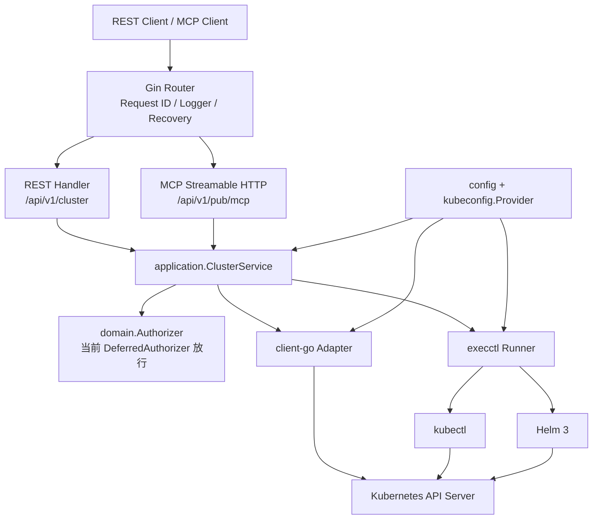

# olixops-k8s-ctl

`olixops-k8s-ctl` 是一个面向受控 Kubernetes 集群的控制服务。它把 Kubernetes 查询、清单校验、常用工作负载操作和 Helm 操作封装成 HTTP API 与 MCP 工具，服务默认监听本机回环地址，并通过固定的集群、Namespace、资源类型和参数边界降低误操作风险。

当前版本已经完成 MCP 基础接入和常用读写操作，但**调用者身份认证、细粒度授权、审批和完整审计仍未实现**。MCP 写工具默认关闭；如果显式打开，当前预留的 `Authorizer` 默认放行，所以只能在受控的本机或隔离网络中测试。

## 先看什么

建议按下面顺序阅读源码：

1. [cmd/main.go](cmd/main.go)：启动、配置、kubeconfig Provider、client-go、命令 Runner 和路由的组装。
2. [internal/interfaces/router/router.go](internal/interfaces/router/router.go)：公开健康接口、REST 控制接口和 MCP 入口。
3. [internal/interfaces/handler/cluster.go](internal/interfaces/handler/cluster.go)：REST 请求绑定和统一响应。
4. [internal/interfaces/mcp/server.go](internal/interfaces/mcp/server.go)、[internal/interfaces/mcp/operations.go](internal/interfaces/mcp/operations.go)：MCP 工具注册、超时、结果和工具到用例的映射。
5. [internal/application/cluster_service.go](internal/application/cluster_service.go)、[internal/application/operations.go](internal/application/operations.go)：Namespace、资源、清单和写操作的业务边界。
6. [internal/domain/resources.go](internal/domain/resources.go)、[internal/domain/authorization.go](internal/domain/authorization.go)：资源白名单与权限扩展点。
7. [internal/infrastructure/kubernetes](internal/infrastructure/kubernetes)：client-go 查询、动态资源、事件、日志、扩缩容和状态适配器。
8. [internal/infrastructure/execctl](internal/infrastructure/execctl)：以参数数组调用 kubectl/Helm 的适配器。
9. [internal/infrastructure/kubeconfig](internal/infrastructure/kubeconfig)：文件、数据库接口和 InCluster kubeconfig Provider。
10. [tests](tests)：从 Gin/MCP 到模拟 Kubernetes API、命令子进程和权限拒绝适配器的契约测试。

MCP 的完整参数、限制和调用示例见 [docs/mcp-development.md](docs/mcp-development.md)；权限控制的后续设计见 [docs/mcp-authorization-design.md](docs/mcp-authorization-design.md)。

## 架构

项目采用 `domain → application → interfaces/infrastructure` 的分层方式，外部 Kubernetes API 和 CLI 都通过适配器隔离：



一次请求的主要路径是：

- 启动时由 Viper 读取配置，由 `kubeconfig.Provider` 取得 kubeconfig，再同时构造 client-go 客户端和 CLI Runner。
- REST 或 MCP 负责协议层解析；`ClusterService` 负责 Namespace、资源 GVK、名称、大小、超时和写开关检查。
- 业务层在访问 Kubernetes 或启动 CLI 之前调用 `domain.Authorizer`。现在的实现是可替换的 `DeferredAuthorizer`，后续接入真实身份和策略时不需要把权限逻辑散落到 MCP handler。
- client-go 用于查询和原生资源变更；kubectl/Helm 只通过参数数组执行，不经过 shell，不接受调用方自带 kubeconfig、连接地址或任意命令参数。
- 返回前对资源详情、日志和命令输出做大小限制及字段过滤；错误对外使用通用信息，避免返回凭据、连接串、完整 YAML 或 CLI stderr。

## 快速启动

开发环境需要 Go 1.26、能够访问目标集群的 kubeconfig，以及执行写操作时可用的 `kubectl` 和 Helm 3。client-go 查询不依赖 kubectl/Helm；当前 Docker 运行镜像也没有内置这两个 CLI，因此容器写操作需要自定义运行镜像或挂载受信任的兼容二进制。

```bash
go run ./cmd
curl -sS http://127.0.0.1:8091/api/v1/pub/health
```

默认配置来自 `configs/config.yaml`：

```yaml
server:
  host: 127.0.0.1
  port: 8091
kubernetes:
  in-cluster: false
  kubeconfig:
    source: file
    path: ""       # 为空时使用 ~/.kube/config
    reference: ""  # database Provider 的记录引用
    context: ""
  write-enabled: true
  allowed-namespaces: []
mcp:
  enabled: true
  write-enabled: false
```

常用环境变量会覆盖同名配置键：

| 环境变量 | 作用 |
| --- | --- |
| `SERVER_HOST` / `SERVER_PORT` / `SERVER_MODE` | 监听地址、端口和 Gin 模式 |
| `KUBERNETES_IN_CLUSTER` | 在集群内使用 ServiceAccount Provider |
| `KUBERNETES_KUBECONFIG_SOURCE` / `..._PATH` / `..._REFERENCE` / `..._CONTEXT` | 选择 kubeconfig Provider 和 context |
| `KUBERNETES_ALLOWED_NAMESPACES` | 限制可见和可操作 Namespace；空列表表示不限制 |
| `KUBERNETES_WRITE_ENABLED` | 业务层 REST/MCP 写总开关 |
| `KUBERNETES_COMMAND_TIMEOUT_SECONDS` | kubectl/Helm 写操作超时 |
| `KUBERNETES_KUBECTL` / `KUBERNETES_HELM` | CLI 路径 |
| `CONTROL_API_KEY` | REST 控制接口的共享 API key |
| `MCP_ENABLED` / `MCP_WRITE_ENABLED` | MCP 总开关和写工具注册开关 |

例如，仅在本机测试 MCP 写能力：

```bash
MCP_WRITE_ENABLED=true \
KUBERNETES_WRITE_ENABLED=true \
go run ./cmd
```

如果把 `SERVER_HOST` 改成非回环地址，必须设置 `CONTROL_API_KEY`，并在 REST 请求中发送 `X-Olixops-Control-Key`。这个 key 目前只保护 `/api/v1/cluster/...`，**不保护公开 MCP 路由**。

## REST 接口

REST 遵循项目约定：查询使用 GET，带参数操作使用 POST，不使用 DELETE/PUT 作为业务接口；响应统一为 `{"code":0,"msg":"","data":{}}`，每个请求透传或生成 `X-Request-Id`。

| 方法 | 路径 | 作用 | 访问边界 |
| --- | --- | --- | --- |
| GET | `/api/v1/pub/health` | 进程健康 | 公开 |
| GET | `/api/v1/pub/ready` | HTTP 服务已启动 | 公开 |
| GET | `/api/v1/cluster/status` | 集群版本和可见 Namespace 数量 | Control API key |
| GET | `/api/v1/cluster/namespaces` | Namespace 列表 | Control API key |
| GET | `/api/v1/cluster/storage-classes` | StorageClass 摘要 | Control API key |
| GET | `/api/v1/cluster/namespaces/{namespace}/resources` | Deployment、StatefulSet、Pod、Service、PVC 摘要 | Control API key + Namespace 范围 |
| GET | `/api/v1/cluster/namespaces/{namespace}/gateway-resources` | Gateway API 资源摘要 | Control API key + Namespace 范围 |
| POST | `/api/v1/cluster/namespaces/{namespace}/metadata` | 更新 Namespace 的 labels 和 annotations | Control API key + 写开关 + Namespace 范围 |
| POST | `/api/v1/cluster/kubectl/apply` | 校验并执行 kubectl apply，可 server-side dry-run | Control API key + 写开关 |
| POST | `/api/v1/cluster/helm/upgrade` | Helm upgrade/install，带 chart 预检查 | Control API key + 写开关 |

REST handler 当前把客户端输入错误统一映射为 400，把服务端/依赖错误统一映射为 503；详细错误只写入受控日志，后续可以按统一错误码继续细化。

## MCP 能力

MCP 地址为：

```text
http://127.0.0.1:8091/api/v1/pub/mcp
```

采用官方 Go SDK 的 stateless Streamable HTTP 和 JSON-RPC。MCP 不使用 REST 的 `code/msg/data` 包装；工具失败通过 MCP 的错误结果返回。请求体上限 4 MiB，读工具默认 30 秒超时，写工具使用 `kubernetes.command-timeout-seconds`。

默认注册 16 个只读工具：

- `cluster_status`、`list_namespaces`、`list_storage_classes`
- `list_resources`、`list_gateway_resources`、`get_resource`、`get_resource_yaml`、`list_resource_objects`
- `list_events`、`get_pod_logs`
- `get_rollout_status`、`get_workload_history`
- `list_helm_releases`、`get_helm_status`、`get_helm_history`
- `validate_manifest`

启用后增加 13 个写工具：

- `dry_run_manifest`、`apply_manifest`
- `helm_upgrade`、`helm_rollback`、`helm_uninstall`
- `scale_workload`、`restart_workload`、`rollback_workload`
- `delete_resource`
- `create_namespace`、`delete_namespace`、`update_namespace_metadata`
- `update_configmap`

MCP 写工具要同时满足 `MCP_WRITE_ENABLED=true` 和 `KUBERNETES_WRITE_ENABLED=true`。工具开关、固定资源白名单、Namespace 范围和参数校验属于功能边界，不等于调用者授权。当前 `Authorizer` 默认允许调用，写工具只能用于受控测试环境。日志、事件、资源 status 和 Pod 日志可能含有业务敏感信息。

资源白名单、Helm 预渲染规则、分页、日志限制、回滚语义和完整 JSON 示例见 [MCP 开发文档](docs/mcp-development.md)。

## 资源与写操作边界

YAML apply、资源详情/列表/删除共享 [internal/domain/resources.go](internal/domain/resources.go) 的固定表：

- `v1`：ConfigMap、Pod、Service、PersistentVolumeClaim
- `apps/v1`：Deployment、StatefulSet、DaemonSet
- `batch/v1`：Job、CronJob
- `networking.k8s.io/v1`：Ingress、NetworkPolicy
- `autoscaling/v2`：HorizontalPodAutoscaler
- `policy/v1`：PodDisruptionBudget
- Gateway API：Gateway、HTTPRoute、TCPRoute 的受控版本

Secret、RBAC、CRD、任意集群级资源、节点操作、Pod exec、kubeconfig 导出和任意 shell 命令均未开放。Namespace 只能通过专用工具管理；`default` 和 `kube-*` 禁止删除。Namespace 元数据更新只允许 labels 和 annotations，并通过显式删除键操作移除元数据。删除是单资源操作并使用 UID precondition；Namespace 删除是显式的大范围动作。扩缩容仅支持 Deployment/StatefulSet，重启和回滚支持 Deployment/StatefulSet/DaemonSet。

Helm 只接受受控的 `repo/chart` 或 `oci://...` 形式，先下载并渲染，再检查存量和目标 manifest，禁用 hooks，不自动创建 Namespace；不保证兼容包含 Secret、RBAC、ServiceAccount 或其他未开放资源的 chart。预渲染不是安全沙箱，也不能保证变更事务性。

## 配置、凭据和安全设计

- kubeconfig 只能由 `internal/infrastructure/kubeconfig.Provider` 提供；文件 Provider 默认读取 `~/.kube/config`，InCluster Provider 使用当前 Pod 的 ServiceAccount。数据库 Provider 目前只有接口，未来必须负责加密存储、权限校验和轮换。
- kubeconfig、token、证书、Helm values 和完整 YAML 不写入日志；CLI 使用 0600 临时文件并在操作结束后清理。
- `kubectl`/Helm 通过 `exec.CommandContext` 的参数数组调用，调用方不能拼接参数绕过白名单。
- `allowed-namespaces: []` 的历史语义是允许全部 Namespace，不能把它当作生产环境默认拒绝策略。
- 当前服务只有单集群别名 `configured`，请求不能选择任意集群或连接地址。
- `domain.Authorizer` 已在所有 REST/MCP 写操作及主要读操作前接入，后续可实现身份、action、集群、Namespace、kind/name、内容策略、审批和审计。设计细节见 [权限控制设计](docs/mcp-authorization-design.md)。

## 测试和源码质量

测试不连接真实集群：使用模拟 Kubernetes HTTP API、MCP SDK、命令子进程和拒绝 Authorizer 验证协议、参数边界、argv、临时文件、权限调用时机和错误处理。

```bash
gofmt -w cmd internal tests
go test ./...
go vet ./...
git diff --check
```

真实集群还需要单独验证 Kubernetes RBAC、Admission、镜像拉取、存储、网关 CRD、Helm 仓库凭据和目标版本兼容性。

## 已知遗漏和风险

下面是当前阅读源码时最需要关注的缺口，按优先级整理：

### 高优先级

1. **MCP 写权限尚未实现**：MCP 路由是公开路由，`DeferredAuthorizer` 默认放行。任何能访问 MCP 的调用者，在两个写开关都打开时都可以执行配置范围内的写操作。
2. **REST 只有共享 API key**：没有用户身份、角色、token 轮换、撤销、Namespace 归属和动作级策略；API key 也不作用于 MCP。
3. **缺少完整审计和审批**：当前日志只记录工具名、读写、耗时和成功状态，没有不可抵赖的主体、策略版本、审批、参数摘要、目标 UID/resourceVersion 和部分成功记录。
4. **运行镜像缺少 kubectl/Helm**：容器中只有 Go 服务程序，写接口在未补充 CLI 的镜像中无法正常工作。
5. **写操作不具备事务性**：多文档 apply、Helm upgrade/rollback/uninstall、Namespace 删除都可能部分执行；超时后不能据此判断没有发生变更。

### 中优先级

1. **集群能力是单集群且没有注册中心**：没有多集群稳定 ID、连接健康状态、凭据轮换和按集群隔离的配置。
2. **Kubernetes 身份还需要最小权限化**：服务使用的 ServiceAccount/kubeconfig 权限必须由部署侧收敛，业务 Authorizer 不能替代 Kubernetes RBAC。
3. **Helm 检查不是沙箱**：模板的 Capabilities、lookup、并发更新和实际 upgrade 之间存在差异，chart 来源、摘要绑定和 release 锁尚未实现。
4. **读取数据可能带敏感内容**：事件 message、资源 status、Pod 日志和错误文本存在业务信息；现有通用字段过滤不能保证脱敏。
5. **缺少限流、并发锁和幂等键**：重复重启、并发 Helm 更新和客户端重试可能造成重复或竞态操作。
6. **状态接口是快照**：扩缩容、重启、回滚和 Helm 操作返回请求结果，不等待应用就绪；没有 watch、流式日志或统一 operation ID。
7. **错误模型仍较粗**：REST 只区分 400/503，MCP 对外使用通用失败信息，客户端难以区分权限拒绝、资源不存在、超时和部分完成。
8. **版本和依赖未完全锁定**：Go、kubectl、Helm、Kubernetes server、Gateway API CRD 的兼容矩阵需要在部署流水线中固定并验证。

## 后续建议顺序

1. 先补 MCP/REST 的认证入口和可信 `Principal`，保留匿名读，写请求要求有效身份。
2. 实现默认拒绝的 `Authorizer`：按 cluster、action、Namespace、GVK、name 和内容策略授权。
3. 明确 YAML apply 的字段权限，避免通过 manifest 间接绕过扩缩容、重启和 ConfigMap 策略。
4. 增加 Helm 来源/版本摘要绑定、实际提交对象复核、并发锁和单独的高风险审批。
5. 为服务配置最小 Kubernetes RBAC，隔离 Namespace 管理身份和普通部署身份。
6. 增加结构化审计、operation ID、状态查询/取消语义、限流、幂等和更细的错误码。
7. 补充包含 kubectl/Helm 的运行镜像、版本探针和真实集群验收流水线。

## 文档索引

- [MCP 开发文档](docs/mcp-development.md)：29 个工具的参数、行为、限制、调用样例和测试覆盖。
- [MCP / REST 权限控制设计](docs/mcp-authorization-design.md)：认证、授权、审批、审计和 Kubernetes RBAC 的后续方案。
- [配置文件](configs/config.yaml)：本地默认配置。
- [MCP 集成测试](tests/mcp_test.go)：MCP 协议和工具发现测试。
- [操作测试](tests/operations_test.go)：资源操作、CLI、日志、Helm、边界和权限扩展点测试。
