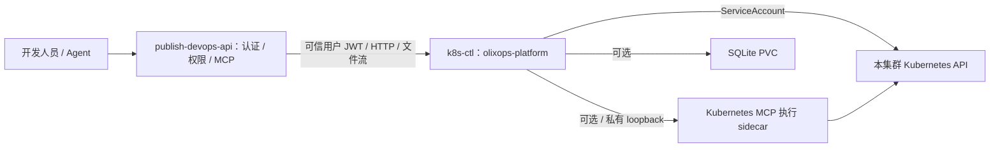

# 平台接入部署包

本目录供 `publish-devops-api → HTTP → k8s-ctl → 本集群 Kubernetes API` 接入使用，独立于旧的 `deployments/catalog.yaml`，不会修改旧清单。用户权限、平台业务对象和统一 MCP 入口由上层实现；本包不实现 Java 客户端或平台权限系统。

控制器通过 Pod ServiceAccount/InCluster Provider 连接本集群，不挂载 kubeconfig。普通 HTTP 开启，主 MCP 默认关闭，Kubernetes 写操作开启；这不是只读部署。JWT 验签、资源类型白名单、目标一致性和 Kubernetes RBAC 继续生效。



## 目录与两种入口

```text
platform/
├── kustomization.yaml       默认入口，引用 base
├── base/                    资源管理、Manifest、Helm、日志
│   ├── config.yaml          JWT、clusterId、能力开关
│   ├── namespace.yaml       控制器 Namespace 和隔离业务 Namespace
│   ├── deployment.yaml     单副本、探针、公钥挂载
│   ├── service.yaml         仅 ClusterIP :8901
│   ├── serviceaccount.yaml
│   └── rbac/                discovery / workloads / namespaces / helm
├── full/                    完整入口，替换配置并添加两个组件
│   └── config.yaml          Shell、终端、文件、Catalog 全开
├── components/
│   ├── exec/                私有执行 sidecar 和业务 Namespace exec RBAC
│   └── catalog/             SQLite PVC、指定 Higress 资源 RBAC
├── scripts/
│   ├── prepare-auth.sh      从已有公钥准备 Secret
│   └── smoke.py             HTTP 接入检查，默认只读
└── examples/nginx.conf      可选 /k8sctl 反向代理片段
```

| 能力 | 默认入口 `platform` | 完整入口 `platform/full` |
| --- | --- | --- |
| HTTP、资源读写、Namespace 操作、Manifest、Helm、日志 | 开启 | 开启 |
| 外部主 MCP | 关闭 | 关闭 |
| Pod 单次命令、持续终端、文件准备/传输 | 关闭 | 开启 |
| 内部 Kubernetes MCP 执行 sidecar | 不部署 | 部署，127.0.0.1:8082，不暴露 Service |
| Catalog 模板/实例、端口台账与后台回收 | 关闭 | 开启 |
| SQLite PVC | 不需要 | 1Gi，使用集群默认 StorageClass |

选择一个入口应用即可。**不要先后应用两个入口来尝试切换功能**：`kubectl apply -k` 不会自动删除旧 PVC、sidecar ConfigMap 或 RBAC。需要降级时先检查持久数据和组件权限，再单独清理不再使用的资源；本包不提供自动销毁脚本。

## 部署前需要填写的内容

1. 确定实际集群 ID，修改所选 `config.yaml` 的 `cluster.id`、`catalog.cluster`，两者必须一致；设置与上层约定的 issuer、audience、kid。示例为 `poc`、`publish-devops-api`、`k8s-ctl:poc`、`platform-v1`。
2. 修改 `base/kustomization.yaml` 的镜像替换项，将 `newName/newTag` 换成已构建并验证、节点可访问的镜像。占位地址不能直接运行。主镜像的构建方法见 [容器部署文档](../../docs/container-deployment.md)。完整入口的 sidecar 固定为现有集成版本 `quay.io/containers/kubernetes_mcp_server:v0.1.2`；若节点不能拉取，预先导入或改为内网镜像，本包不会自动准备镜像。
3. 默认控制器 Namespace 是 **`olixops-platform`**，业务 Namespace 是 **`developer-demo`**。独立 Namespace 避免旧 Service 的 `app` 选择器选中新控制器。更换控制器 Namespace 时同步清单、RoleBinding subjects、ConfigMap generator、Secret 准备脚本和 `server.public-url`；不要在根 Kustomization 随意加 `namespace` 字段，它会把业务及 Higress 的 RoleBinding 也迁移。
4. 增加业务 Namespace 时，按部署需求准备 Namespace 清单、workloads/helm RoleBinding 和 Namespace metadata `resourceNames`；开启 Shell 需准备 exec Role/RoleBinding。应用不再维护 Namespace 名单，旧 allowed-namespaces 字段不生效；本部署包的 Kubernetes RBAC 示例仍仅授权示例 Namespace，按需扩展，不自动扩大集群授权。
5. 完整入口核对已有 Higress Service/Gateway 名称、Gateway API/TCPRoute CRD、端口池 30000–30200、模板 PVC 的 StorageClass `local-path`。SQLite PVC 默认 StorageClass 与模板使用的 `catalog.default-storage-class` 是两项配置。使用 Catalog 时 `higress-system` 也必须在 Kubernetes allowlist，但不放入 exec allowlist。
6. 确认上层能访问 ClusterIP/DNS，或配置内网代理；上层后端地址可配置为 `http://olixops-k8s-ctl-platform.olixops-platform.svc.cluster.local:8901`。控制器 `server.public-url` 默认留空，文件接口返回相对路径；该配置不接受集群内 HTTP 地址，如需绝对 URL，使用实际 HTTPS 地址。没有公网 Ingress、TLS 证书或平台网络打通步骤。

## JWT 和公钥 Secret

当前平台操作器认证支持 **RS256、RSA 公钥不少于 2048 位**，并支持读取 Setting 共用 Redis 中的个人 PAT。Publish 完成业务权限后透传当前调用者的 JWT/PAT，操作器使用同一个 Bearer Token 认证，不签发内部 JWT，不接受 `X-User-Id` 覆盖身份。JWT 必须保留真实用户 ID，claim 使用 `staffuserid`，并匹配配置的 `exp/iss/aud/kid`。JWT/PAT 接入细节见 [认证说明](../../docs/authentication.md)。

仅从可信来源取得**公钥**，不把签名私钥或真实 JWT 放进仓库。使用当前 kubectl context 执行：

```bash
# 先由操作者确认当前目标集群。
kubectl config current-context
bash deployments/platform/scripts/prepare-auth.sh /secure/path/platform-public.pem
```

脚本只创建/更新 `olixops-platform` Namespace 和 Secret `olixops-k8s-ctl-platform-auth`，不创建业务应用，不生成平台签名私钥。Secret 的键为 `platform-public.pem`，挂载到 `/var/run/k8s-ctl-auth/platform-public.pem`。非 root 控制器通过 fsGroup 读取 0440 文件。没有 Secret 时 Pod 会 FailedMount，这是缺少部署前置条件；不再依赖旧 `olixops-control` Secret。

配置不使用运行时环境变量，不提供本地 PAT 签发或 API key 降级路径。更新公钥 Secret 后应用不会热加载，需要重启控制器，并与上层协调密钥切换。

## 生成、检查与应用

```bash
# 离线生成，不连接 Kubernetes API，不拉取镜像。
kubectl kustomize deployments/platform > /tmp/k8s-ctl-platform.yaml
# 或选择完整能力入口：
kubectl kustomize deployments/platform/full > /tmp/k8s-ctl-platform-full.yaml

# 公钥、镜像与范围核对完成后，二选一：
kubectl apply -k deployments/platform
# kubectl apply -k deployments/platform/full

kubectl -n olixops-platform rollout status deployment/olixops-k8s-ctl-platform
kubectl -n olixops-platform get pods,svc
```

生成的 ConfigMap 名含内容摘要，修改配置后重新 apply 会更新 Pod 模板并重建单副本。Secret 更新不改变模板摘要，需显式执行：

```bash
kubectl -n olixops-platform rollout restart deployment/olixops-k8s-ctl-platform
```

单副本 + Recreate 与 SQLite/内存会话模型一致。重建会中断终端并使旧会话和文件引用失效。health/ready 仅代表进程状态，不验证 Kubernetes RBAC、sidecar 可用、Higress 或外部 Redis 协议。

## 按能力分组的 RBAC

| 文件 | 授权范围和用途 |
| --- | --- |
| `base/rbac/discovery.yaml` | 集群 Namespace、StorageClass、GatewayClass、TCPRoute 只读及 API discovery；TCPRoute 跨 Namespace 查询用于共享端口冲突核对 |
| `base/rbac/workloads.yaml` | 业务资源白名单读写、日志/事件/工作负载历史；通过 RoleBinding 仅绑定 `developer-demo` |
| `base/rbac/namespaces.yaml` | Namespace 创建；更新/删除仅允许指定的 `developer-demo`，仍受 Kubernetes RBAC 限制 |
| `base/rbac/helm.yaml` | `developer-demo` 的 Secret 读写，支持 Helm 默认 release 存储 |
| `components/exec/rbac.yaml` | `developer-demo` 的 Pod 查询、日志以及 `pods/exec` GET/CREATE |
| `components/catalog/rbac.yaml` | `higress-system` 中指定 Service/Gateway 更新和网关查询 |

没有授予 `cluster-admin`、RBAC 管理或任意 CRD/集群资源写权限。Kubernetes RBAC 不能通过 `resourceNames` 限定 Namespace **create**；Namespace 创建规则单独拆出，必须保留应用 allowlist。若平台不提供 Namespace 创建，删除对应 creator ClusterRole 和 Binding；保留其他规则。

Helm 的 release Secret 授权实际覆盖这个业务 Namespace 的所有 Secret，RBAC 不能按 Helm 标签过滤。不要把它误认为“仅允许改 release Secret”。若不提供 Helm，移除 `base/kustomization.yaml` 中的 `rbac/helm.yaml`。通用 YAML/资源 API 仍不支持创建/读取 Secret 内容。Chart 若包含 ServiceAccount、RBAC、CRD 或白名单之外资源，不能保证可安装；需要审核 Chart 并单独授权，不扩大到 cluster-admin。

## Shell、终端、文件和 Catalog 注意事项

完整入口不再要求下层逐用户配置 grants；上层每次调用前完成权限判断，下层保留可信 JWT、范围、Pod UID 和用户绑定句柄。目标 Pod 必须满足现有执行资格（包含 `k8s-ctl/exec-enabled: "true"` 标签及运行中容器），控制器自身仍禁止执行。标签应加到业务工作负载的 Pod template，不能只加在 Deployment metadata。拦截器为独立 `allow-all` 占位策略，不会识别危险命令。

终端配置示例为总计 128 会话、每用户 8 会话、空闲 300 秒、最长 1800 秒；这是配置值，没有几百人并发容量结论。一次命令使用私有 sidecar；持续终端/文件复用已有 client-go 流适配。不能把关闭主 MCP 理解为移除内部执行组件。

文件需要上层流式代理，保持用户 JWT、Content-Length、单次引用、超时和取消，不全量缓冲、不自动重试。下层返回的内网 URL 必须由上层转换为自己的传输入口。`server.public-url` 设置了前缀时，代理必须移除该前缀。参见 [HTTP 使用说明](../../docs/http-operator-guide.md) 与 [代理片段](examples/nginx.conf)。

完整入口启用 SQLite Catalog 及沙箱到期回收后台任务。**同一个 Higress 端口池只能由一个 Catalog 协调器管理**。不能让旧服务和新服务分别拿独立 SQLite 同时分配 30000–30200；迁移前停止旧协调器、备份数据库、核对存量台账和卷挂载。本包创建新 PVC，不自动搬迁旧数据、模板和 Secret。Redis/PG 凭据仍由已有 Kubernetes Secret 供模板引用，不提交示例真密码。

## 接入验收

先在本地转发控制器，使用调用者自己的 JWT/PAT。这里不自动生成或打印 token：

```bash
kubectl -n olixops-platform port-forward svc/olixops-k8s-ctl-platform 8901:8901
# 在另一终端执行，默认仅查询：
python3 deployments/platform/scripts/smoke.py \
  --base-url http://127.0.0.1:8901 --token-file /secure/path/platform.jwt \
  --cluster-id poc --namespace developer-demo

# 显式执行隔离 ConfigMap 的校验、创建、查询、更新和删除：
python3 deployments/platform/scripts/smoke.py \
  --base-url http://127.0.0.1:8901 --token-file /secure/path/platform.jwt \
  --cluster-id poc --namespace developer-demo --write-test
```

脚本验证健康/就绪、缺少/错误 JWT 返回 401、认证能力信息、Namespace 与资源查询。写测试只使用随机命名的新 ConfigMap，不部署镜像、不安装工具、不修改已有业务数据；回收前检查 UID，删除返回 accepted 表示异步受理。写入响应丢失或结果未知时不重试，打印需人工核对的资源名。脚本不输出 token 或资源正文，拒绝重定向以免凭据转发。

错误 audience、伪造用户身份、跨用户终端、Pod 替换、Ctrl+C、上传/下载前缀及中断已有本地模拟集成测试，参见 [本次验证记录](../../docs/testing/platform-package-2026-11-11.md)。它们仍须在平台真实链路中验收；本地渲染通过不能替代真实集群验收。
