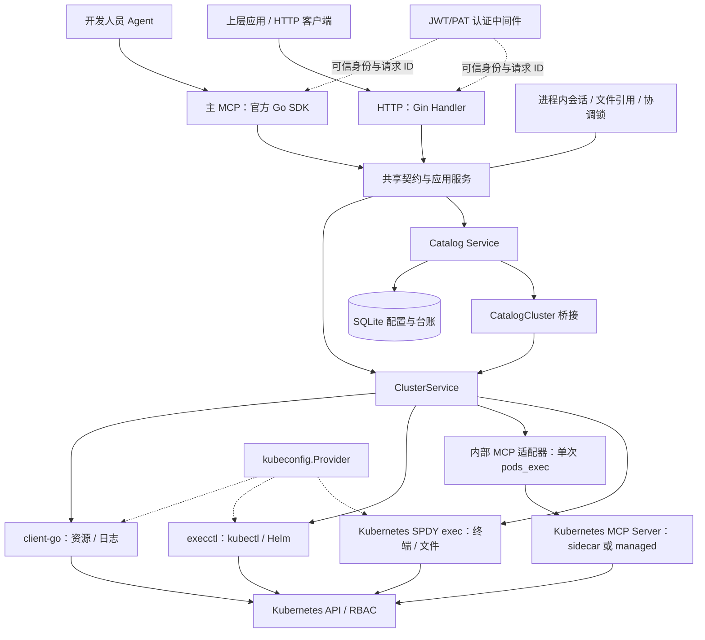
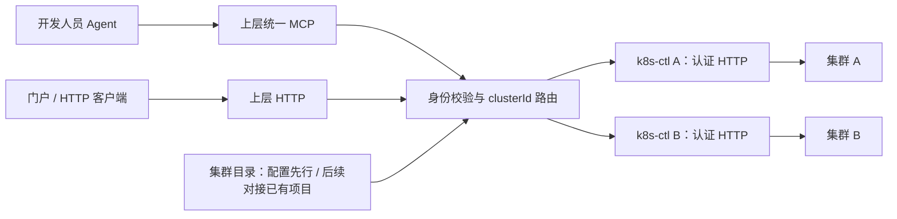

# k8s-ctl 开发交接文档

交接基线：2026-11-08 当前工作区。面向接手开发、联调和部署的同事。

**项目定位：Dev Ready 开发环境自助平台的单集群操作器。** 外部 Agent 理解自然语言，通过 MCP 调用；上层应用通过 HTTP 调用。k8s-ctl 不内置大模型，一个实例固定操作一个 Kubernetes 集群，负责资源执行、标准服务配置、部署与端口台账。

当前已具备 HTTP/MCP 双入口、JWT/PAT、资源与 Helm 操作、日志、单次 Shell、持续终端、文件上传下载及 SQLite 标准服务目录。适合开展内部试用与上层集成；用户资源归属授权、多集群上层平台、多副本 HA 和规模压测尚未完成。

> 双入口改造基线为 `4e25d9b`。2026-11-07 的审核修复、回归测试与本交接文档已纳入本批提交；接手时应获取包含本文件的版本及后续提交，不能只停留在 `4e25d9b`。部署镜像是否包含最新代码需要另外核实，Git 提交不等同于线上已发布。

## 1. 接手先做什么

1. 获取完整代码和未提交变更，执行 `git status --short`、`git diff --stat`，核对 [审核修复记录](testing/review-fixes-2026-11-07.md)。不要覆盖工作区现有修改。
2. 阅读本文件的架构、状态归属和开发路径，再按第 8 节启动独立测试实例。正式实例使用的配置、镜像摘要和密钥位置由当前维护者通过内部渠道交接。
3. 跑自动化测试，核对 [HTTP/MCP 覆盖矩阵](http-mcp-coverage.md) 与 [OpenAPI](http-openapi.json)。全能力启用时为 57 个业务工具；实际工具集合取决于开关。
4. 选一个独立测试 Namespace 验证入口、可信身份、Shell/终端、上传下载和清理。先完成本实例接入，再开展上层多集群集成。
5. 交接收口时记录实际 Git 提交、镜像版本、运行配置及验收结果；提交和部署不是文档编写过程自动完成的步骤。

文档权威顺序：当前源码与配置校验、当前接口契约/自动化测试、本交接文档和最新指南、历史设计及测试快照。旧部署说明可能仍使用公开 MCP/API key，旧工具清单可能只有 29 或 50 项，不能直接作为当前认证部署的依据。

## 2. 框架设计与边界

### 2.1 技术栈与分层

| 层次 | 目录与关键文件 | 职责 |
| --- | --- | --- |
| 启动与装配 | [cmd/main.go](../cmd/main.go) | 加载配置、初始化认证、选择 Provider、组装 client-go/CLI/上游执行器、初始化 Catalog/终端、启动定时回收及 Gin |
| HTTP 接口 | [router/router.go](../internal/interfaces/router/router.go)、[handler/operations.go](../internal/interfaces/handler/operations.go) | 路由、认证中间件、请求解码、HTTP 状态及响应；不重复实现集群业务 |
| MCP 接口 | [mcp/server.go](../internal/interfaces/mcp/server.go)、[mcp/operations.go](../internal/interfaces/mcp/operations.go)、[mcp/terminal.go](../internal/interfaces/mcp/terminal.go) | 官方 SDK 工具注册、协议适配、超时、工具结果与错误 |
| 共享契约 | [application/api](../internal/application/api) | 类型化输入输出、默认值及参数语义、严格 JSON 校验、能力接口、统一错误、工具/路由对应表 |
| 应用服务 | [cluster_service.go](../internal/application/cluster_service.go)、[operations.go](../internal/application/operations.go)、[application/catalog](../internal/application/catalog)、[application/auth](../internal/application/auth) | 资源范围、写开关、业务校验、执行编排、目录状态机、认证/PAT 生命周期 |
| 领域定义 | [domain](../internal/domain) | 资源类型、目标/身份、执行结果、Catalog 模型、Authorizer 与流式执行接口 |
| 基础设施 | [infrastructure](../internal/infrastructure) | Kubernetes、kubectl/Helm、kubeconfig、JWT、SQLite、内部 Kubernetes MCP 适配器 |
| 公共支撑 | [pkg/logger](../pkg/logger)、[pkg/response](../pkg/response) | 统一日志、请求关联、REST 响应 |

当前依赖包括 Go 1.26、Gin、Viper、Zap、官方 MCP Go SDK、client-go 和纯 Go SQLite 驱动，精确版本以 [go.mod](../go.mod) / go.sum 为准。SQLite 嵌入进程，不需要另部署数据库服务。Kubernetes/CLI 版本兼容仍应通过部署流水线核验。

### 2.2 当前运行架构



认证在进入业务 HTTP/MCP 前完成。对外只有一个 Gin 进程和监听端口；HTTP 和 MCP 直接调用应用服务，不经过本机 HTTP 或 MCP 相互转发。

执行路径必须区分：

- 资源读取、日志、部分更新走 client-go；YAML apply、Helm 等走参数数组调用的 CLI。
- **单次任意 Shell** 复用内部 Kubernetes MCP Server 的 `pods_exec`，容器命令作为参数数组传递，不在控制服务本机执行。
- **持续终端与文件流** 走 Kubernetes SPDY exec 适配器；单次上游 `pods_exec` 不能替代持续会话。
- 主 MCP 是给客户端的协议入口；内部 Kubernetes MCP Server 是执行组件。关闭主 MCP，HTTP 单次 exec 仍需要内部执行组件。sidecar 表示同 Pod 辅助容器，不是 Istio。
- kubeconfig 统一经过 Provider。文件和 InCluster 已实现；数据库凭据 Provider 只有扩展接口，尚未实现加密、权限和轮换存储。

### 2.3 关键状态放在哪里

| 状态 | 位置 | 生命周期与注意点 |
| --- | --- | --- |
| 标准模板、实例配置修订、部署、端口及事件 | Catalog SQLite，路径由 `catalog.database-path` 配置 | 需要持久化；不是 Kubernetes 的完整备份 |
| PAT 状态、摘要、有效期、撤销记录 | PAT SQLite，路径由 `auth.pat.database-path` 配置 | 仅有验签公钥不能替代本地 PAT 数据库；升级需保留数据库及签名密钥 |
| 实际工作负载、数据卷和网关路由 | Kubernetes / PVC | 删除服务与删除持久数据不是同一操作；目录删除默认保留数据库 PVC |
| 终端连接、输出缓冲、上传下载引用 | 当前进程内存 | 重启即失效；引用绑定用户与 Pod UID；不能直接分流到另一副本 |
| 实例部署锁、共享入口协调锁 | 当前进程内存 | 不能支撑多个独立进程同时协调同一入口 |
| 配置和认证密钥 | 配置文件、挂载文件或 Kubernetes Secret | 启动时读取，修改需重启；禁止提交真实凭据 |

当前部署按单副本设计。不能通过直接增加 Deployment replicas 获得可靠 HA。

## 3. 已完成能力

| 模块 | 已实现 | 必须保留的边界 |
| --- | --- | --- |
| 双入口 | 全能力配置下 57 个 MCP 业务工具都有 HTTP 对应；认证管理、能力查询和文件流另有 HTTP 接口 | 工具名不是 URL，映射见覆盖矩阵；关闭 HTTP 后 MCP 文件流仍需可访问 |
| 集群与资源 | 状态、Namespace、StorageClass、资源列表/详情/原始 YAML、事件、Gateway 摘要 | 固定资源白名单与 Namespace 范围；不返回 kubeconfig，不开放任意 CRD |
| Namespace | 创建、删除、labels/annotations 增改及显式删除键 | metadata 专用操作不允许改其他字段；受保护 Namespace 不可删除 |
| Manifest / 工作负载 | validate、server dry-run、apply、scale（含 0）、restart、rollout/history、rollback、删除 | 创建和一般更新走 YAML；UID 前置校验防止误删替代对象；成功不等于就绪 |
| Helm | list/status/history、upgrade/install、rollback、uninstall | 固定 argv；执行前渲染和检查；禁用 hooks；没有事务回滚保证 |
| ConfigMap / Secret | ConfigMap data 合并更新；模板可引用支持的已有 Secret | 未提供 Secret 通用 CRUD；不要以为每类资源都有专用 CRUD 接口 |
| 日志与 Shell | Pod 日志、受控动作与显式开启的任意单次命令 | 无持续日志订阅；输出保留实际上游含义，不虚构退出码或独立 stdout/stderr |
| 持续终端 | open/write/read/close、TTY、控制字符中断、输出游标、用户归属、过期和并发限制 | 通过请求轮询读取，不是 SSH 服务或现成 WebSocket 终端；重启失效 |
| 文件 | 准备引用、认证 HTTP 下载/上传、单次消费、长度和 SHA-256 检查、暂存与清理 | 上传只创建新文件；无固定文件大小上限、断点续传和目录上传；网关仍可能限制大小/超时 |
| JWT / PAT | 公司 RS256 JWT；个人 PAT 创建、列表、撤销、到期与数据库检查；离线初始 PAT | 不提供公司登录页；认证不代表资源归属权限已完成 |
| 配置目录 | SQLite 模板版本、实例、配置修订、预览、部署记录和访问验证 | 不是通用配置分发/订阅中心，ownerId 还不是强制授权依据 |
| 标准服务 | Redis、PostgreSQL、MySQL、MongoDB、Milvus、Nginx、Python JupyterLab；沙箱 TTL 回收 | 七类流程有自动化覆盖，不等于七类都在当前集群完成真实验收 |
| Higress 端口 | 默认 30000–30200，共 201 个；同步实际占用、预留/绑定/释放和事件 | 范围配置不证明 LB 已开放全部端口；先同步实际 Service/Gateway/TCPRoute |
| 交付 | Dockerfile、ConfigMap/Secret/PVC、RBAC 示例、Higress 前缀与 sidecar 组件 | 旧默认部署仍可能未启用认证，必须检查最终配置 |

**Redis 的实现不要混淆：** 当前标准目录 Redis 是 StatefulSet + PVC；仓库有 Redis Operator 演示清单，但尚未把 Operator 纳入标准目录部署链路。需要产品化 Operator 时，另行设计 CRD 能力、状态观测、删除和存储保留策略。

### 最近完成的审核修复

2026-11-07 修复了上传失败且客户端停发时的读取阻塞、终端排队输入取消、CLI 超时原因丢失、Catalog HTTP 状态笼统、不完整 JSON 长期占用连接。同步抽取共享终端契约、MCP 注册包装及文件引用管理。普通 JSON 读取限时 10 秒（或更早的操作截止时间），读取后解除网络 deadline；文件字节流不套这个短超时。具体回归证据见 [审核修复记录](testing/review-fixes-2026-11-07.md)。

## 4. 三条重点调用链

### 4.1 普通 HTTP / MCP 操作

请求 → Request ID / 日志 → 验证 JWT/PAT → 协议解码 → 共享输入契约 → 应用层参数、范围、写开关与 Authorizer → client-go/CLI/执行适配器 → 对应协议输出。

HTTP 使用 `/api/v1/cluster/资源/操作`；Catalog 保留 `/templates`、`/services`、`/ports`。无参数查询 GET，带参数业务 POST；保留原路径参数 GET。普通 HTTP 成功/错误都为 `code/msg/data`，错误原因位于 `data.reason`。MCP 使用 SDK JSON-RPC 与工具错误语义，文件下载成功返回字节流。

`Outcome`、`TimedOut`、`UpstreamError` 需要一起判断。已经开始的 CLI 变更被取消或超时后返回 `execution_unknown`，先查实际状态，不能自动重试；Catalog 另有自己的 requestId/部署恢复流程，不能推广成所有写操作都可重试。

### 4.2 终端与文件

终端：open 校验身份和目标，创建会话 → write 发送命令及换行/控制字符 → read 使用 cursor 读取 base64 输出与 nextCursor/lostBytes → close。open 请求结束不结束整个终端。终端默认缓冲 256 KiB、单次读取上限 64 KiB；用户和总会话数、空闲期和生命周期由配置控制。Viper 默认值为全实例 16 个会话、每用户 4 个、空闲 300 秒、总生命周期 1800 秒，可由配置覆盖；默认限额不等于几百人容量承诺。

文件：MCP 或 HTTP prepare → 返回五分钟、单次、用户绑定的引用和 URL → 同一用户携带 Bearer 进行 HTTP 字节流传输。上层转发需要保持 Content-Length、有限缓冲、取消传播和外部前缀；不能把整个文件塞进 JSON 或 MCP 返回值。

上传需要已有可写目录及容器内 `/bin/sh`、head、wc、sha256sum、mkdir/rmdir、rm、ln 等工具；下载需要 tar。rootfs 只读或非 root 权限可能导致目录不可写，服务不会提升容器权限。上传先暂存，验证大小/摘要后发布；目标已有文件不覆盖。远端不可达或授权撤销时清理可能失败。下载已经开始后发生错误会中断流，不在文件末尾追加 JSON。

### 4.3 标准服务与端口

发现模板/默认值 → 指定 Namespace → 保存实例配置修订 → prepare 冻结 YAML/摘要并预留端口 → deploy 执行检查、网关与资源变更 → 查询观测状态 → verify-access 做协议验证。

保存配置本身不部署、不领用端口。部署保存阶段与资源 UID；相同 requestId/参数可复用原流程，参数不一致拒绝。`applied`、Kubernetes `ready`、服务端协议检查、开发人员网络实际可达是不同结果。删除先清受管路由和资源，确认后才释放端口；未知结果或清理未完成时保留台账，不能手工把端口标为空闲来绕过恢复。

实现入口：[catalog/deployments.go](../internal/application/catalog/deployments.go)、[catalog/ports.go](../internal/application/catalog/ports.go)、[catalog_cluster.go](../internal/application/catalog_cluster.go)。详见 [标准服务目录](standard-services.md)。

## 5. 认证、权限与配置开关

### 5.1 当前身份模型

公司 JWT 校验签名、issuer、audience、有效期等；用户 ID 从可信 claim 得到（优先 staffuserid，回退 sub），写入 context。个人 PAT 还要校验本实例数据库里的摘要、用户、到期和撤销状态。不得接受任意 `X-User-Id` 覆盖可信身份。

现有 Namespace/资源范围、写开关、RBAC、诊断 grants、终端/文件用户绑定继续生效。目标 Pod 通常需 `k8s-ctl/exec-enabled: "true"` 标签，或满足已批准 UID 的校验分支，并接受宿主网络/进程空间等目标限制；具体以 [pod_exec.go](../internal/infrastructure/kubernetes/pod_exec.go) 为准。仅开 Shell 配置不代表任意 Pod 都可执行。不过通用 [DeferredAuthorizer](../internal/domain/authorization.go) 默认放行；[Shell interceptor](../internal/application/shell/interceptor/interceptor.go) 当前 AllowAll 也只是扩展占位。启用拦截器不等于已经识别危险命令。原始 YAML、日志与文件不增加自动脱敏，后续统一权限方案再处理。

### 5.2 开关关系

| 配置 | 接手时需要知道 |
| --- | --- |
| `http.enabled` | 默认 true，控制普通业务 HTTP，不误关健康/认证管理或 MCP 必需的文件流 |
| `mcp.enabled` | 对外主 MCP；HTTP 操作器可关闭 |
| `mcp.write-enabled` | 控制 MCP 写工具注册，不决定 HTTP 写入是否允许 |
| `kubernetes.write-enabled` | 集群变更开关；不能等同于 SQLite 配置写入开关 |
| `pod-exec.enabled` / `shell.enabled` | 执行及任意 Shell/终端/文件能力需显式配置；保留现有认证、目标和 RBAC 要求 |
| `mcp.diagnostics-only` | 兼容旧受限诊断行为，完整操作器设 false |
| `cluster.id` / `catalog.cluster` | 稳定集群身份；未设置前者时沿用后者，两者显式不一致拒绝启动 |
| `server.public-url` | 文件地址使用，可包含 `/k8sctl`；上层代理应重写成自己的地址 |
| `shell.terminal.*` | 调整会话总数/每人限额及空闲/总生命周期；以实际配置为准，需要压测后制定容量 |

认证开启后主 MCP 为 `/api/v1/mcp`；`auth.enabled=false` 的兼容配置可能暴露 `/api/v1/pub/mcp`，普通 HTTP 则走旧 ControlKey。不要把示例默认配置直接作为内部多人开放方案。对外部署同时核对仓库 [AGENTS.md](../AGENTS.md) 的非回环监听与凭据要求。

## 6. 后续框架方向：上层路由、下层单集群



上图为后续设计，当前仓库只实现下层。上层项目位置及已有集群信息接口尚待确认，不能假设已与 olixops-agent 打通。

上层负责集群目录、用户交互、统一 MCP、路由和跨实例引用映射；下层保留实际 Kubernetes 操作及业务边界。上层无需再连接每个下层主 MCP，也不需要集中读取各集群 kubeconfig。复用下层 HTTP，不做进程内插件化或在同一实例动态切换集群。

上层调用时使用下层信任的 JWT 并保留真实 UserID，按集群设置并校验 audience。上层 PAT 不会自动被所有下层的 PAT 数据库认可；如需 PAT 到下层 JWT 转换，应由上层验证并签发受信短期 JWT，当前下层没有令牌交换服务。

通过 `/api/v1/operator/capabilities` 核对 clusterId、runtimeId、版本及实际开关。runtimeId 是每次启动的实例身份。终端/文件引用需在上层绑定 clusterId、backendId、runtimeId 和用户；后续请求必须回到原实例，不能因故障偷偷换集群。文件先采用上层流式代理，保留长度与取消语义。详细方案见 [多集群路由设计](multi-cluster-routing-design.md)。

## 7. 建议开发路径与验收标准

按既定方向，先把集群操作、双入口和上层集成完善，再统一实施资源归属权限；在权限完成前限定内部试用范围。以下是建议阶段，不是已经完成的功能承诺。

| 阶段 | 开发事项 | 完成标准 |
| --- | --- | --- |
| P0 接手基线与发布 | 收齐工作区修复，建立提交/镜像基线，准备独立测试配置和 Secret，验证实际 Higress 入口 | 最新版本可追溯；HTTP/MCP、认证、终端中断、文件往返通过；测试资源清理并留记录 |
| P1 上层最小接入 | 确认上层项目，配置集群目录，封装下层 HTTP 客户端，可信 JWT、能力检查、统一 MCP、会话/文件路由 | 两个真实集群的同名资源不会串；伪造身份/错误 audience 被拒绝；不向用户泄露下层凭据 |
| P2 补齐操作与产品流程 | 依据需求补能力缺口、统一 Agent Skills、标准服务实际镜像/存储/LB 验收；需要 Redis Operator 时另设计模板适配 | 功能沿用两入口一套业务；新增工具进入矩阵/OpenAPI；状态失败与清理路径有测试和环境证据 |
| P3 资源归属权限 | 集中 Authorizer；Namespace/资源的 create-user-id、管理员、标签继承与归属变更；逐步替代临时精确 grants | 本人/他人/管理员/无归属/伪造标记/Pod 重建等场景验证；列表、YAML、Shell、文件、Catalog、apply/Helm 不能绕过 |
| P4 容量与可靠性 | 会话/文件限流和配额、几百人压测、指标与审计；超时未知结果追踪、台账恢复、SQLite 备份恢复演练 | 明确并发预算、失败率和资源占用；慢传输/大文件可控；重启恢复和备份可演练 |
| P5 按需演进 | 多副本协调、共享状态或会话固定路由、断点续传、凭据轮换及更多模板 | 先给出数据一致性与迁移设计，再开启 HA；数据库替换本身不会自动解决会话与协调问题 |

权限设计尚需确定：create-user-id 放 label 还是 annotation、Namespace 和资源级的优先关系、旧资源缺失归属如何迁移、管理员是全局还是按集群、列表是否过滤、控制器 Pod 标签继承，以及元数据修改/apply/Helm 如何防止伪造归属。管理员配置曾暂称 `administor`，正式字段待设计，不要当作已有配置使用。

更完整的待办统一维护在 [roadmap](roadmap.md)。危险命令策略、资源授权、审计是不同职责；不能只做命令关键字过滤就宣称完成了权限控制。

## 8. 本地开发、部署与接手验收

### 8.1 独立启动

前置：Go 按 go.mod；测试使用模拟后端，不需要真实 kubeconfig。实际服务需要可用 Provider；启用相关能力时准备 kubectl、Helm 及内部 Kubernetes MCP Server。下面操作使用独立配置目录，避免覆盖已有开发配置。

```bash
mkdir -p .local/handover
cp configs/config.standalone.example.yaml .local/handover/config.yaml
# 编辑该配置：真实公私钥文件路径、PAT DB 路径、Namespace、grants、managed binary。
# 本地用 file Provider；临时不要验证标准服务时保持 catalog.enabled=false。
go run ./cmd --config-dir ./.local/handover
```

示例有占位路径，未填写不能直接启动。密钥准备详见 [认证说明](authentication.md)。`auth.enabled` 与 `auth.pat.enabled` 都启用后，管理员使用同一份配置、同一数据库和签名密钥签发首个 PAT：

```bash
go run ./cmd/pat --config-dir ./.local/handover \
  --user-id '<真实用户ID>' --name handover-test --days 30
```

token 仅在创建时返回，放个人凭据工具，不写入 Git 或共享交接文档。服务不提供任意无认证 user-id 换 token 接口。

另一个终端中，`K8S_CTL_BASE` 与 `K8S_CTL_PAT` 仅代指调用者本地保存的地址和令牌，不要求服务端使用环境变量配置：

```bash
curl --fail-with-body "$K8S_CTL_BASE/api/v1/pub/health"
curl --fail-with-body "$K8S_CTL_BASE/api/v1/operator/capabilities" \
  -H "Authorization: Bearer $K8S_CTL_PAT"
curl --fail-with-body "$K8S_CTL_BASE/api/v1/cluster/namespaces" \
  -H "Authorization: Bearer $K8S_CTL_PAT"
```

主 MCP 客户端连接 `$K8S_CTL_BASE/api/v1/mcp`，每次请求带 Bearer。终端与文件 curl 示例见 [HTTP 操作器指南](http-operator-guide.md)。`/health` 和 `/ready` 当前是进程状态响应，不能证明 Kubernetes 连接、RBAC 或 Catalog 部署可用；必须另做能力/资源查询。

### 8.2 集群部署

从 [Dockerfile](../Dockerfile)、[deployments/catalog.yaml](../deployments/catalog.yaml)、[RBAC](../deployments/rbac.yaml) 和 [sidecar 组件](../deployments/components/kubernetes-mcp) 阅读。完整步骤见 [部署说明](container-deployment.md)，认证配置以最新认证指南为准。

- 使用 InCluster Provider 与 ServiceAccount；配置合适 RBAC，不把开发人员 kubeconfig 分发给客户端。
- ConfigMap 保存普通配置，Secret 挂载认证密钥及需要的 control key；仍引用 `olixops-control` 的旧配置必须先准备 Secret，否则 FailedMount。切换认证时同步检查旧挂载，不能只删除 Secret。
- 保留单副本、SQLite 持久卷和 PAT 数据；变更配置/密钥需重启。原本机 SQLite 内容不会自动进入新的 PVC。
- Higress 将 `/k8sctl` 前缀剥离后转发到 `/api/v1/...`，服务内部路由不重复加前缀。public-url 使用用户实际可达的外部地址。
- 操作器示例关闭主 MCP、启用认证 HTTP；完整单次 exec 仍须安装内部执行组件。不要把内部 sidecar 端口开放给开发人员。
- 网关不自动重试写请求；文件代理检查请求体大小、长度、缓冲与超时。没有应用级文件大小上限不代表网关无限制。

### 8.3 测试与验收证据

代码变更执行 gofmt，并运行：

```bash
go test ./... -count=1
go vet ./...
go test -race ./internal/application ./internal/application/api ./internal/application/shell ./internal/interfaces/httpio ./internal/interfaces/handler ./internal/interfaces/mcp ./tests -count=1
go run ./cmd/api-docs
git diff --check
```

文档生成器使用本机模拟端点发现工具并生成契约，不访问真实集群。涉及 Shell 拦截器修改时另对 `./internal/application/shell/interceptor` 跑 race 测试。生成后检查矩阵/OpenAPI 的 diff，避免无意修改兼容契约。

| 证据 | 已验证范围 | 不代表什么 |
| --- | --- | --- |
| [2026-11-06 双入口验收](testing/http-operator-2026-11-06.md) | 模拟上层代理/身份/流；隔离真实 Namespace 的 HTTP 资源、日志、单次 Shell、终端 Ctrl+C、2 MiB 二进制往返、零字节；主 MCP 发现与 YAML 查询 | 未逐项真实执行所有 Helm/Catalog 变更，未部署实际多集群上层 |
| [2026-11-07 审核修复](testing/review-fixes-2026-11-07.md) | 全量测试、vet、相关 race；本机真实 TCP/HTTP1/HTTP2 与模拟集群/CLI 的取消、超时、上传失败清理 | 本轮修复没有再操作真实集群，不等于线上已更新或通过规模压力测试 |

交接文档编写本身只核对源码、文档和链接，不重新宣称执行了上述环境验收。新同事需要在接手环境记录新的测试结果。真实验证限定隔离资源，复用已有缓存镜像，不拉取新镜像或在现有业务容器安装工具，不改业务数据；结束后回读确认清理。

## 9. 后续改代码的落点

- **新增资源操作**：先确定 domain/共享 input-output 和应用方法，再补 client-go/CLI 适配器；HTTP 和 MCP 各做薄适配；更新 [api/routes.go](../internal/application/api/routes.go)、覆盖测试与生成文档。不在两个入口各写一遍业务。
- **新增权限**：从可信 context 取身份，在共享应用层 Authorizer 中实现，覆盖两个入口；现有 Namespace/资源/写开关与 RBAC 不得被新策略替代掉。
- **新增 Shell 策略**：放在独立 interceptor 目录，通过决策结果返回可展示原因；不在 Handler 中散落关键字判断，也不在本机执行用户命令。持续终端输入可能是分段控制字符，策略设计不能假设每次 write 是完整命令。
- **新增标准服务**：从 Catalog 模板、软件定义和默认值入手；补渲染、不可变配置约束、状态观测、协议验证、回收与存储保留测试。不要只新增一份 YAML 就认定流程闭环。
- **修改终端或文件**：保留用户绑定、Pod UID、单次引用、取消/过期、游标/lostBytes、长度和完整性语义；增加竞争/中断测试。未知结果不能包装成成功或自动重试。
- **新增凭据存储**：扩展 kubeconfig.Provider，不让 client-go/CLI 直接依赖数据库路径；先设计加密、授权和轮换，不记录原始 kubeconfig/token/证书。

HTTP/MCP 的身份、请求 ID、取消和超时沿 context 贯穿。日志统一使用 pkg/logger，接口修改同步 README、测试和 OpenAPI。具体规范见 [AGENTS.md](../AGENTS.md)。

## 10. 交接资料索引与待补信息

| 主题 | 阅读入口 |
| --- | --- |
| 项目总览 / 功能清单 | [README](../README.md) |
| HTTP 接入、curl 与开关 | [操作器指南](http-operator-guide.md)、[独立配置](../configs/config.standalone.example.yaml)、[操作器配置](../configs/config.operator.example.yaml) |
| 工具与接口字段 | [覆盖矩阵](http-mcp-coverage.md)、[OpenAPI](http-openapi.json) |
| Shell / 终端 / 文件 | [Shell 指南](shell-mcp.md)、[内部 MCP 集成](kubernetes-mcp-integration.md) |
| 身份与后续权限 | [认证指南](authentication.md)、[授权设计](mcp-authorization-design.md)、[待办](roadmap.md) |
| 标准服务 / 端口 / 恢复 | [标准目录](standard-services.md)、[快捷部署](standard-service-quickstart.md) |
| 上层多集群 | [路由设计](multi-cluster-routing-design.md)、[双入口实施基线](http-mcp-unified-entry-plan.md) |
| 环境部署与 RBAC | [容器部署](container-deployment.md)、[RBAC 指南](kubernetes-rbac.md) |

接手双方还需线下确认：当前实际运行的 Git/镜像版本、配置来源、clusterId/Namespace 范围、密钥和数据库管理人、PVC/备份位置、Higress 地址/证书/已开放端口、内部执行组件版本、上层集群目录项目及负责人。上述信息不要由文档里的历史 PoC 地址推断；真实 token、私钥、kubeconfig 不进入交接文档。
