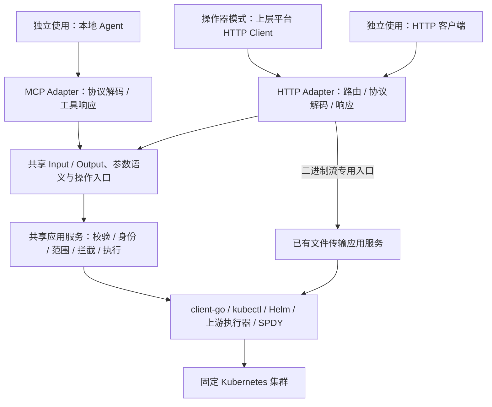

# HTTP / MCP 双入口与共享契约实施计划

日期：2026-11-06。状态：本期下层双入口已实现并验收；正文保留实施基线，最终使用方式见 [操作器指南](http-operator-guide.md)，证据与未覆盖范围见 [测试记录](testing/http-operator-2026-11-06.md)。

## 1. 交付目标与范围

k8s-ctl 提供完整的认证 HTTP 操作入口和现有 MCP 入口，两者共用请求契约、参数语义、业务校验、执行逻辑及错误模型。支持两种用法：

- **独立使用**：一个 k8s-ctl 对接一个集群；本地 Agent 直接使用 MCP，客户端也可使用 HTTP。文件字节仍经 HTTP 传输。
- **作为上层操作器**：上层提供统一 MCP/网页 API，按 clusterId 选择实例，通过内部 HTTP 调用 k8s-ctl；下层主 MCP 可以关闭，执行能力保持可用。

“挂载到上层”首期指独立部署、网络调用，不把本项目编译为上层的 Go 插件，也不让同一个实例动态切换 kubeconfig。本次交付下层契约和接入示例/模拟上层验证，不在尚未确定的上层项目里实现完整多集群平台。

在现有 Gin 服务中补齐 HTTP 能力，不新起监听端口或第三种 RPC 服务，不再复制一组 public/internal 同业务路由。内部调用与独立调用使用同一套认证 HTTP 契约。沿用现有 /api/v1/cluster/... 及 Catalog 资源分组，避免与 /api/v1/services（标准服务实例）混淆。



## 2. 代码调查与 EnvVault 参考

参考项目为本机 `/Users/vincent/GolandProjects/env-vault`（只读参考，不修改）：

| 参考位置 | 借鉴内容 | 本项目处理 |
| --- | --- | --- |
| internal/interfaces/router/router.go | v1/pub/认证分组、资源下集中注册操作；依赖共享装配 | 继续使用花括号呈现分组，不另造平铺路由 |
| internal/interfaces/handler/project.go | Handler 依赖应用层 IService，转换 DTO 后调用用例 | 按资源能力依赖小接口，避免所有 Handler 绑定整个 ClusterService |
| internal/application/project/project.go | 类型明确的 Input 与应用服务接口 | 提取共享输入输出与业务参数语义，不在 HTTP/MCP 重写规则 |
| pkg/response/response.go | code/msg/data、业务错误与 HTTP 错误分开 | 复用当前响应基础，定义本项目错误映射；不照搬全部 HTTP 200 业务错误或原始 err.Error() 输出 |
| internal/interfaces/middleware/auth.go | 验证 issuer/audience、PAT 状态及用户上下文 | 复用 k8s-ctl 已有 JWT/PAT；保持 context.Context 的取消和可信用户身份 |

EnvVault 本身仍有 Handler DTO/校验，不把它描述为已经实现了本项目所需的 HTTP/MCP 共享解析。参考设计原则，不引入其数据库、Redis、主密钥、gRPC、权限中心或整套审计。

当前 k8s-ctl 已有的基础及差距：

- HTTP/MCP 已共享 ClusterService、Catalog Service，但 MCP 私有 input、HTTP Request 和结果包装存在重复。例如 apply 的 dryRun 返回以及 Namespace metadata 结果包装需要明确兼容策略。
- MCP 使用 Go SDK 类型参数和 schema；HTTP 有 ShouldBindJSON、独立 JSON decoder 和 bindSmallJSON 多种路径。严格字段规则、请求大小、默认值和错误表现未统一。
- `/api/v1/cluster/pods/exec` 已调用 ExecPodCommand，应用服务支持显式启用的 action=shell；无需再开发一套 Shell 执行器。现有 HTTP bindSmallJSON 的 8 KiB 限制与应用支持的 64 KiB 命令长度不一致，需按操作统一限制。
- 持续终端 open/write/read/close、上传/下载准备引用目前由 MCP 暴露；文件数据流已有 HTTP 接口。
- MCP 包装设置超时，部分 HTTP 路径没有对应预算；普通 cluster Handler 吞掉具体错误，MCP 也常返回笼统失败。
- ValidatePodExec 要求 MCP.Enabled / MCP.WriteEnabled；MCP.DiagnosticsOnly 还控制 HTTP/Catalog 注册。必须解除跨协议开关耦合。
- 当前会话和传输引用属于一个运行实例；单副本、重启失效和用户归属约束不能因增加 HTTP 而丢失。

## 3. “一套解析逻辑”的实现边界

目标是**同一个业务输入，只定义一次含义；同一个操作，只执行一条业务路径**。HTTP 请求和 MCP JSON-RPC 必然有不同的协议外壳，不强行把它们交给同一个原始报文解析器。

建议组织：

```text
internal/application/contracts/  共享输入输出类型、字段说明与无副作用参数归一化
internal/application/            现有资源用例；必要的类型化操作入口与统一错误
internal/application/catalog/    复用已有 Catalog Input/Output，不重新定义
internal/domain/                 现有终端、文件与身份类型，保持单一来源
internal/interfaces/handler/     HTTP 分组、绑定、响应及文件流
internal/interfaces/mcp/         MCP schema/工具注册、协议响应
internal/interfaces/router/      入口开关、认证、资源路由装配
```

该目录为实施建议；优先复用现有类型，不为搬目录改写全部应用服务。不建立万能 map[string]any 调度器，不让 HTTP 请求绕道本机 MCP，也不让 MCP 通过本机 HTTP 调用自己。

共享内容：字段与 JSON 名称、必填/省略语义、分页默认值和上限、资源目标、业务输入校验、允许的 Namespace 字段、稳定错误原因和结果含义。数量 0、false、空字符串、未提供字段必须按契约区别，必要时使用指针/显式存在性，不用重复赋默认值掩盖差异。

协议独有内容：HTTP method/path/body 解码、MCP JSON-RPC 与 SDK schema 校验、响应 envelope。共享参数归一化和校验放在进入基础设施之前的应用入口；保留 SDK 协议校验，但不只依赖 schema 实施业务限制。

普通 JSON 入口统一未知字段、尾随 JSON、非法类型、空 body 和空对象的处理，并覆盖 MCP 等价输入。请求体上限按操作分类：小元数据、Manifest/values、Shell/终端输入分别定义，MCP 外层需为 JSON-RPC 开销留余量。二进制文件流不经过 JSON 解析器或普通操作的请求体大小限制。

## 4. HTTP 契约与覆盖范围

实施第一步生成逐工具对照清单：operationId、现有 MCP 工具名、HTTP method/path、共享输入输出、只读/写属性、开关、超时、错误、兼容方式。按实际注册和配置覆盖，不用固定工具总数代替清单；认证管理等 HTTP 专有能力不强制新增 MCP 工具。

以下路径是设计候选，未新增接口：

| 能力组 | HTTP 入口/候选动作 | 交付要求 |
| --- | --- | --- |
| 实例与集群 | GET /api/v1/cluster/status；GET /api/v1/operator/capabilities | 保留状态接口；增加受保护的 clusterId、运行实例 ID、API 版本和启用能力 |
| Namespace | /api/v1/cluster/namespaces 下 list/create/delete/metadata | 保留现有无参 GET 与 metadata 路径；带参数操作 POST，仅修改 labels/annotations |
| 资源、事件、网关 | /api/v1/cluster/resources 下 list/get/yaml/delete；events/list 等 | 覆盖现有通用资源工具，分页、选择器、原始 YAML 等语义一致 |
| 工作负载 | /api/v1/cluster/workloads 下 rollout/history/scale/restart/rollback | 复用现有工作负载方法，不为 Deployment 等复制通用 CRUD |
| Manifest | /api/v1/cluster/kubectl 下 validate/dry-run/apply | 保留已有 apply，明确本地校验和服务端 dry-run 的不同 |
| Helm | /api/v1/cluster/helm 下 list/status/history/upgrade/rollback/uninstall | 查询和写操作都覆盖，保留现有 upgrade 路径 |
| ConfigMap 等 | 对照 update_configmap 与其他已有资源工具补齐 | 不引入超出现有工具范围的任意字段更新 |
| Pod 日志与命令 | POST /api/v1/cluster/pods/logs、/exec | 复用现有入口，统一输入限制、超时、执行结果和错误 |
| 终端 | POST /api/v1/cluster/pods/terminals/open、write、read、close | 共用同一会话 Manager，保留 cursor、base64、lostBytes 和状态语义 |
| 文件准备 | POST /api/v1/cluster/pods/files/prepare-download、prepare-upload | 返回已有引用与传输地址，复用身份/Pod UID/有效期和单次使用规则 |
| 文件传输 | 保留 POST /api/v1/cluster/pods/files/download、upload | 二进制流、Content-Length、校验、取消与清理保持现有语义 |
| Catalog | 复用 /templates、/services、/ports 下现有入口 | 对照全部 Catalog MCP 能力、输入输出与错误，补遗漏不重复建模块 |

新增路由遵守 GET 无参数查询、POST 带参数操作，不用业务 PUT/DELETE。保留现有带路径参数 GET 作为兼容入口，不在本次静默移除。路由按 v1 → 资源 → 操作集中注册，并用花括号包裹。

既有 HTTP 路径和 MCP 工具名保持兼容。共享逻辑接管后，旧结果形状由薄适配器维护；确有不能兼容的变化须在实施清单中标出，不直接破坏旧客户端。schema 或 body 收紧先盘点现有调用与测试。

## 5. 错误、执行状态与上下文

在应用层定义可识别的错误类别与稳定 reason：参数无效、未认证、无权限、未找到、冲突、功能关闭、上游不可用、超时/取消、执行结果未知。保留可展示的字段原因和业务上下文，不统一返回“检查输入”，也不直接回传可能包含凭据的底层错误。

- HTTP：保持 code/msg/data。按类别映射 400/401/403/404/409/503/504 等，code 与 HTTP 错误一致；稳定业务原因和必要结果放 data。现有错误契约通过兼容测试保护。
- MCP：协议错误由 SDK 处理；业务错误通过工具错误语义返回，使用相同 reason 和说明，不能直接返回 HTTP envelope。
- 单次命令的 TimedOut、UpstreamError、Outcome 等即使没有 Go error 也必须被识别；保留“未执行/已完成/结果未知”的差异，不能把 HTTP 200 或 err=nil 等同远端命令成功。
- 请求身份、X-Request-Id、取消、超时通过标准 context.Context 贯穿，不使用丢失取消信号的背景上下文；终端生命周期独立于 open 请求，close/过期负责结束会话。
- 普通查询、写操作、短轮询、Shell 和文件流分别配置预算；不把统一短超时套在持续会话和大文件流上，不自动重试非幂等写操作。
- 文件响应开始后不能再输出错误 JSON；继续保持流中断语义。文件内容、token、kubeconfig 与完整命令/配置不写入普通请求日志。

## 6. 两种运行方式与开关解耦

计划新增明确的 HTTP 操作入口开关，保留 MCP 入口开关；健康/就绪和认证管理入口单独管理。配置名称在第一阶段冻结并写入配置示例，不能在实现中形成多套互相覆盖的 mode 判断。

| 场景 | 业务 HTTP | 主 MCP | 文件流 HTTP | 执行与认证 |
| --- | --- | --- | --- | --- |
| 独立使用 | 开启 | 可开启 | 按文件能力启用 | 本地 JWT/PAT、业务写开关、Shell 显式开关 |
| 上层操作器 | 开启 | 可关闭 | 按文件能力启用 | 可信 JWT 用户身份、同一套执行检查 |
| Agent 直接接入且关闭普通 HTTP | 可关闭 | 开启 | 启用文件工具时仍需开启 | 不能让关闭普通 HTTP 导致 MCP 返回无法访问的文件 URL |

写操作由共享业务写开关约束，各入口可保留更严格的入口限制；MCP.WriteEnabled 不再成为 HTTP 执行的前提。保留已有 MCP 只读模式，不因新增配置默认放开写操作。旧配置缺省值与 diagnostics-only 行为建立回归矩阵，新配置冲突启动时报明确错误。

实例增加稳定 cluster.id（与 catalog.cluster 来源统一）和每次启动变化的 runtimeId；能力接口从实际启用状态产生，不返回凭据/内部连接配置。业务请求不增加下层切换集群参数；上层核对实例身份后路由。客户端请求中的 userId 或任意 X-User-Id 不能覆盖认证用户。

操作器首期支持使用现有受信 JWT 方式接入并验证 issuer/audience/UserID。上层个人 PAT 校验与短期内部 JWT 签发在上层实现；本项目不新建令牌交换服务，也不假设不同实例共享 PAT 数据库。用测试签发方模拟上层身份验证链。

AGENTS.md 现有“任意命令仅主 MCP 入口”的文字需在实施时按本次授权更新为“显式启用的认证 HTTP/MCP Shell 共享入口”，同时保留独立拦截器与目标限制。当前计划阶段不改规范或解除检查。

## 7. 文件与终端的上层接入契约

本期下层补齐准备接口和终端 HTTP 接口；提供模拟上层转发示例与集成测试，不把多集群代理写入单集群 k8s-ctl。

上层将平台传输/会话 ID 映射到用户、clusterId、backendId、runtimeId、下层引用及有效期。下载和上传都经平台流式代理，有限缓冲、保留背压和上传 Content-Length；不缓存完整文件，不把文件转成 base64 放进 JSON。保留 no-store、文件名等必要响应头，不传播下层凭据。

终端 open 后的 read/write/close 与文件传输固定到原实例；实例重启或用户不匹配明确失败，不切换集群重试。文件准备返回相对/绝对 URL 的既有行为需在反向代理前缀下验证；上层重新生成平台 URL，下层不接受调用者随意指定外部 base URL。

阶段二继续保留：断点续传、目录传输、并发配额、GB 级与几百用户压测、独立文件网关/短期传输凭证直连、多副本共享状态。本期不增加固定文件大小上限，也不声称所有网关无大小限制。

## 8. 实施阶段与完成条件

### P0：冻结契约与兼容基线

- 生成全量 MCP→HTTP→应用方法对照表，盘点条件注册能力和 HTTP 专有接口。
- 固定分组路由、输入输出、错误模型、超时/大小预算、配置缺省与兼容策略。
- 记录既有测试基线和工作区未提交修改，保护既有用户改动。
- 产物：接口矩阵、错误/配置矩阵与 OpenAPI 草案；不得只凭工具数量宣称覆盖完整。

### P1：共享契约与公共适配基础

- 按操作迁移重复 Input/Output，保留已有 domain/Catalog 类型；必要时补类型化应用入口。
- 统一参数归一化、语义校验、业务错误、上下文与操作预算。
- 先用资源查询、Namespace metadata、apply 验证双入口等价，继续保护旧响应。
- 完成条件：同一组合法/非法业务输入经两入口得到等价行为，MCP 原工具仍可用。

### P2：补齐常用资源与 Catalog HTTP

- 按矩阵补 Namespace、资源 YAML、事件、工作负载、Manifest、Helm 等入口。
- 对齐已有 Catalog/端口 HTTP 与 MCP，避免第三套业务实现。
- 完成条件：当前常用集群 MCP 能力都有对应的类型化 HTTP 契约和覆盖测试。

### P3：终端、文件、开关与操作器身份

- 统一现有 exec，补终端四操作和文件准备两操作；数据传输沿用当前入口。
- 解耦入口开关与业务开关，验证 MCP 关闭后的 Shell/文件/终端 HTTP。
- 增加实例身份与能力接口，独立/操作器配置示例，可信 JWT 接入测试。
- 完成条件：HTTP 可以独立完成与 MCP 等价的终端及文件流程；跨用户/实例拒绝和取消生效。

### P4：上层接入验收与文档交付

- 用模拟上层验证 HTTP 调用、JWT 用户传递、终端固定路由、文件流式代理与 /k8sctl 前缀。
- 单实例真实集群验收独立 MCP 与 HTTP 操作器模式；双真实集群路由验收归属于后续上层多集群开发，不与本期混为一谈。
- 同步 README、MCP/HTTP 使用说明、OpenAPI、配置示例及待办；API 文档可导入 ApiPost，实际远程同步按后续明确要求执行。
- 完成条件：交付覆盖矩阵、测试结果、兼容说明与可直接执行的 curl/上层接入示例。

## 9. 测试与验收清单

- [ ] 契约：未知字段、额外 JSON、必填/省略、0 副本、false、分页、超长请求、YAML/values、Namespace 非元数据字段拒绝；双入口语义一致。
- [ ] HTTP：成功、参数错误、认证、拒绝、找不到、冲突、超时、执行结果未知均可区分；404/405/异常也保持响应结构，MCP 保持协议格式。
- [ ] 兼容：旧 HTTP 路径、MCP 工具名、关键输出字段和配置仍可用；只读、diagnostics-only 与写开关不会被迁移绕过。
- [ ] 独立模式：JWT/PAT + MCP + HTTP 正常；MCP 文件工具返回可用传输地址。
- [ ] 操作器模式：MCP 关闭，HTTP 资源、Shell、持续终端、文件准备和上传下载全部可用；错误 JWT/audience/UserID 伪造被拒绝。
- [ ] 终端：open/read/write/close、Ctrl+C（TTY）、超时、取消、游标/丢字节、重启失效、跨用户与 Pod 替换。
- [ ] 文件：零字节、普通/二进制内容、SHA-256、重复引用、过期引用、无权限/只读路径、截断上传、取消清理、下载中断、代理长度/前缀与有限缓冲；不额外拉镜像或安装容器工具。
- [ ] 写操作测试使用隔离命名空间/模拟后端，清理只限测试资源，不操作现有业务数据。
- [ ] 代码实施阶段运行 gofmt、go test ./...、go vet ./...；会话/并发相关改动运行相关 race 测试。每阶段记录验证证据。

## 10. 不在本期实现

上层完整多集群平台、集群信息项目对接、资源 create-user-id/admin 授权、审批与权限中心、会话共享存储、多副本 HA、断点续传和容量治理。现有认证、grants、Scope、Kubernetes RBAC 与默认放行拦截扩展点保持有效，不以本次入口重构为由关闭。

相关设计：[多集群路由](multi-cluster-routing-design.md)、[开发待办](roadmap.md)、[README](../README.md)。
