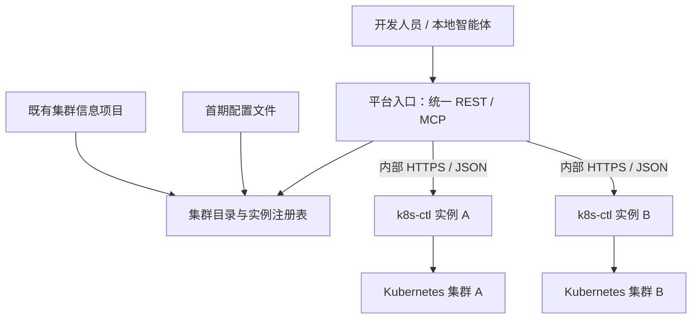

# 多集群设计：上层选择，单集群实例执行

> 2026-11-06 双入口更新：主 MCP 现有业务工具均有认证 HTTP 对应入口，终端及文件准备接口已补齐；关闭主 MCP 后仍可作为 HTTP 操作器使用。共享契约、最新开关和调用示例见 [HTTP 操作器指南](http-operator-guide.md)，上层多集群路由仍待实现。

日期：2026-11-06。状态：设计建议，未实现。依据当前 k8s-ctl 代码及用户提出的“上层按集群 ID 选择实例”方向整理。

## 结论与部署模型

推荐把多集群注册、选择和路由放在平台上层。一个 k8s-ctl 部署实例固定控制一个 Kubernetes 集群，上层根据稳定 clusterId 找到该实例的访问客户端，通过认证的内部 HTTP API 调用其单集群能力。上层统一提供 MCP，首期文件采用上层流式转发；下层主 MCP 作为可选的独立接入方式，不作为平台调用的必要依赖。

这里的“实例”指独立部署的 k8s-ctl 服务。上层缓存的是该服务的连接客户端，不是每次请求重新启动一套控制程序。第一阶段每个集群的 k8s-ctl 保持一个副本。多个单集群实例也可以部署在同一管理环境，只要它们分别绑定自己的 Provider、执行器与数据目录。

优先选择每个集群内各部署一个 k8s-ctl，使用本集群 ServiceAccount 和现有私有 Kubernetes MCP sidecar。上层能访问这些实例的受控 HTTPS 地址即可，不需要集中持有所有集群的 kubeconfig。跨集群 Service DNS 通常不能直接作为上层访问地址，配置实际可达的内部网关地址。



既有集群信息项目和配置文件是注册表的可替换来源，不作为同时可写的两份主数据。先接配置，后续切换到既有项目提供的接口。

## 代码依据与当前差距

- [cmd/main.go](../cmd/main.go) 启动时构建一个 kubeconfig.Provider、client-go Client、execctl.Runner、ClusterService、终端 Manager 与 Catalog Service。
- [ClusterService](../internal/application/cluster_service.go) 固定持有一个 client、runner、执行器、终端及传输状态；默认 cluster 标识目前为 configured。
- [Router](../internal/interfaces/router/router.go) 的可变 services 参数只使用 services[0]，不是已实现的多集群注册表。
- [Provider](../internal/infrastructure/kubeconfig/provider.go) 负责单集群凭据的加载来源，适合继续由各执行实例持有，不应承担平台集群目录职责。
- [Catalog Service](../internal/application/catalog/service.go) 绑定一个集群和网关，存在实例内锁与后台回收任务。多集群第一阶段应隔离实例数据目录。
- [认证服务](../internal/application/auth/service.go) 对 PAT 除验签外还查询本地 token 元数据，独立数据库不会自动认可另一实例签发的 PAT。
- 终端和上传/下载引用保存在实例内存，且绑定真实 UserID。它们需要上层路由保持实例一致性。

本次也检查了 /Users/vincent/Desktop/codes.nosync/olixops-agent：已有 Agent 规格中的 cluster 字段及待接入规划，未看到已实现的完整集群目录。该项目的历史部署 Worker 规划与当前 k8s-ctl 已实现能力需要重新对齐，不能把旧 README 中的“ctl 仅骨架”当成当前事实。用户所指“已有所有集群信息的项目”的名称、路径及接口尚待确认；本次未修改 olixops-agent。

## 三层职责

| 层 | 负责 | 保持的约束 |
| --- | --- | --- |
| 集群信息项目 | 稳定 clusterId、名称、环境、启停及元数据 | 作为集群目录的权威来源，复用现有 ID |
| 平台路由模块 | 配置/接口加载、实例映射、HTTP 连接池、身份传递、能力探测、对外 REST/MCP 与内部 HTTP 适配及有状态句柄映射 | 对外一个入口，错误明确，不自动切换到别的集群 |
| 单集群 k8s-ctl | 本集群资源、Helm、日志、Shell、文件传输、目录部署与端口台账 | 一个实例固定一个集群，复用当前业务用例 |

平台路由模块可以放在 olixops-agent 的 integrations/application 中。如果已有集群信息项目本身适合提供统一后端，也可以在那里承载。现在无需单独创建第三个独立网关项目，先用一个清晰模块封装。

## 首期配置与接口

建议多集群映射配置由上层读取，而 k8s-ctl 继续读取单集群配置。以下字段为设计示例，当前程序尚不支持直接加载：

```yaml
cluster-registry:
  source: file
  clusters:
    - id: poc
      name: POC 开发集群
      enabled: true
      backend-id: poc-ctl
      base-url: https://poc-ctl.internal.example/k8sctl
    - id: dev-b
      name: 开发集群 B
      enabled: true
      backend-id: dev-b-ctl
      base-url: https://dev-b-ctl.internal.example/k8sctl
```

base-url 表示 k8s-ctl 服务入口，不是 Kubernetes API Server 地址；凭据通过挂载文件/Secret 引用加载，不把真实 token 写入配置示例。注册时校验唯一 ID、地址格式、实例宣告的 clusterId、协议版本与能力。

建议内部接口保持简洁：ClusterDirectory.List/Resolve 提供目录；BackendRegistry.Resolve(clusterId) 返回可复用的单集群 HTTP 客户端。配置文件和既有项目接口是目录接口的两个 adapter。加载结果使用带版本的快照，先校验再原子替换。当前已分配的会话仍固定到原实例；新请求用新快照。首次加载失败不开放对应集群；失效快照是否允许新操作必须有明确期限，第一版失效时拒绝新写入。

上层 REST 可采用 GET /api/v1/clusters 列出可用集群，以及 POST /api/v1/clusters/:clusterId/... 执行带参数操作；具体资源路径沿用项目规范。内部映射到 k8s-ctl 原有单集群 REST 路径。

上层主 MCP 保留原工具名称，对集群相关工具增加明确的 clusterId，另提供 list_clusters。示例：

```json
{"name":"upload_pod_file","arguments":{"clusterId":"poc","namespace":"demo","pod":"app","container":"app","path":"/app/demo.json"}}
```

处理顺序为：验证当前用户 → 解析 clusterId → 获取注册客户端 → 验证实例身份/能力 → 将工具参数映射为单集群 HTTP 请求 → 调用该实例的业务接口 → 返回带目标标识的结果。适配工具 schema 与能力，不复制 50 多个 Kubernetes 业务实现。tools/list 可以保持平台支持的稳定版本契约，各集群的能力差异由 list_clusters/能力信息明确展示；不支持的操作明确拒绝。

第一阶段要求用户明确选择 clusterId。不提供全局“切换当前集群”状态；工作流选定后冻结目标。连接池可按 backendId/配置版本复用，用户身份、终端会话和传输引用不能跨用户混用；请求认证信息不能保存到所有用户共用的可变客户端默认 Header 中。

## 本地 Agent 如何接入：上层 MCP Server 调用下层 HTTP

开发人员只配置平台统一 MCP 地址，例如 https://dev-platform.example/api/v1/mcp，并使用平台签发的个人 PAT。这个地址是设计示例，当前尚未部署。

上层应用增加 MCP 适配模块，与网页 HTTP 入口共用实例注册表和单集群 HTTP 客户端。上层无需再运行一个大模型，也不需要额外实现面向下层的 MCP Client。

```text
本地 Agent（MCP Client）
  → 上层应用 /api/v1/mcp（MCP Server）
  → 集群路由、可信用户身份与 HTTP 客户端
  → 选中的 k8s-ctl 认证 HTTP API
  → 单集群 application 服务
  → Kubernetes
```

对外 MCP Server 负责 initialize、tools/list、tools/call 等协议处理。Agent 在 tools/list 中看到 list_clusters 和带 clusterId 的业务工具；上层将其转换为下层 HTTP 请求，并把普通 code/msg/data 响应映射为 MCP 工具结果与错误，不能直接把 HTTP envelope 当成 JSON-RPC 响应。原始 YAML、日志、终端数据和文件元数据保留已定义的输出契约。

例如，本地 Agent 调用 cluster_status({clusterId: "poc"})，平台选择 poc-ctl，发送 GET /api/v1/cluster/status，再返回归属于 poc 的结果。资源接口按当前规范组织：查询使用 GET，带参数操作使用 POST，不增加业务 DELETE/PUT；具体工具到接口的映射需要逐项定义和测试。

k8s-ctl 的 HTTP Handler 与可选 MCP Handler 共用 application 服务，不复制业务逻辑。当前主 MCP 嵌在同一个 Gin 进程中，可以保留为独立部署和直接调试入口。平台集成不依赖它；内部单次执行依赖的 Kubernetes MCP sidecar/managed 组件则属于另一层适配器，不能把两者混为一谈。

当前已解除执行能力与主 MCP 开关的硬依赖，http.enabled=true 时可关闭主 MCP。Shell 的 HTTP/MCP 共享入口保持显式开关与独立拦截器，项目规范已同步。

现有 57 个主 MCP 业务工具均已有 HTTP 对应入口，持续终端、文件准备和二进制传输全部可通过 HTTP 调用。覆盖矩阵和契约见 [操作器指南](http-operator-guide.md)；上层适配、路由和平台文件代理尚未开发。

内部接口要求认证与受控网络，不放进 /api/v1/pub/...。开发人员不需要配置下层实例地址或持有 Kubernetes 凭据。MCP 到 MCP 可作为兼容接入方式，但不是本设计首期方案。

文件和终端的统一入口流程见下一节及 [README 架构图](../README.md)。新增普通 Web 应用不会自动提供统一 MCP，本节中的上层适配与路由仍需开发。

## 身份与现有 PAT

服务间连接认证与用户身份是两个维度。统一服务账号可以标识网关，但不能把所有用户都变成该账号，否则终端归属、上传下载引用和未来 create-user-id 都会失真。

短期验证可使用上下游都信任、issuer/audience 一致的公司 JWT。正式接个人 PAT 时，推荐在统一入口校验 PAT 与撤销状态，再签发短期内部 JWT 传给执行实例；保留可信 UserID，绑定目标实例的 audience（例如 k8s-ctl:poc），实例验签。内部签名私钥仅由入口持有，执行实例只需要受信公钥。当前 company JWT 验证器可作为适配基础，但信任配置、声明与能力仍需明确实现和测试。

不能仅透传任意 X-User-Id；也不能假设把各实例 PAT 公钥设成一样就足够，因为当前还有 token 数据库有效性校验。平台可以集中管理 PAT；无需为每个执行实例复制一份个人 token 数据库。资源所有者/admin 等细粒度授权按既定权限阶段推进，基础身份传递不能跳过。

## 会话、文件与状态数据

**终端和上传/下载必须固定执行实例。** 上层记录用户句柄对应的 clusterId、backendId、运行实例 generation、下游 sessionId/transferId 和可信 UserID。后续读取、写入、关闭、上传、下载都走同一个实例。实例重启后原句柄失效，不能把旧句柄静默指向重建实例。第一版每集群一个副本，后续多副本需实例亲和路由或共享状态设计。

**文件走统一入口的流式 HTTP。** MCP 返回给客户端的 URL 应为平台地址；平台把它映射到已经绑定的执行实例，并替换为相应下游引用。不要把私网地址和下游服务凭据暴露给开发人员，也不要让请求指定任意 upstream URL。上传必须保持 Content-Length，不能转成当前下游不支持的未知长度 chunked 请求；下载错误需保留流中断语义，不能在错误后伪装正常完成。取消、背压和网关超时也需要端到端测试。

**准备与传输分开。** Agent 调用上层 MCP 准备工具；平台通过待补的下层 HTTP 接口创建传输引用，记录用户、clusterId、backendId、运行实例标识、下层引用及有效期映射；向 Agent 返回平台传输 ID 和平台 URL。Agent 再用 curl 和平台 PAT 传输文件，平台验证引用并转换为下层认可的身份。首期不要求客户端直连每个 k8s-ctl。

上层用有限缓冲边读边写，不整体载入文件或强制落盘；配套关闭不必要的整文件代理缓冲，保留背压。上传方向为本地 → 平台 → k8s-ctl → 容器，下载方向相反。消费单次引用的请求不盲目重试；取消需关闭下游连接并触发已有清理。准备或传输失败必须给出可区分结果，响应已开始后的下载错误以断流表达。

**容量优化作为后续阶段。** 文件带宽与长连接都会经过上层，无固定应用大小上限不代表没有网关限制或容量上限。验收需覆盖长度、哈希、慢客户端、取消、中断、Higress 缓冲/请求体/超时设置。GB 级文件、并发配额、断点续传和压测另行实施。后续可拆独立传输网关；客户端直连则要求各集群入口可达及新增短期限定传输凭证，不能直接返回当前下层 URL 和凭据。

**台账先保持分集群存储。** 每个 k8s-ctl 使用独立 SQLite/PVC、端口池和实例目录，第一版不共享同一个数据库文件。平台索引使用 (clusterId, instanceId)、(clusterId, gatewayId, protocol, port) 等复合标识，防止同名资源和相同端口跨集群混淆。模板集中管理和台账迁移可以后续实施，不需要为实现路由先搬迁所有业务数据。

## k8s-ctl 已完成的操作器基础

1. 补齐常用资源、主 Shell、持续终端与文件准备引用的认证 HTTP 接口，复用 application 服务；拆分 MCP 入口开关与执行业务开关。
2. 增加稳定的本实例 cluster.id，以及实例启动 generation；将硬编码 configured 与 catalog.cluster 的身份来源统一，兼容现有单集群配置。
3. 提供认证后的实例身份/能力信息，包含 clusterId、版本、启用功能和运行实例标识，上层在注册/连接时核对，防止地址配错集群。
4. 接入既定上层可信身份传递方式，保留现有应用层检查、Shell 拦截器和 UserID 归属。
5. 文件返回信息和状态错误支持上层代理；日志记录 clusterId、请求 ID、实例 ID。

Deployment、Pod、Helm、日志等单集群业务函数继续使用固定客户端，不必给每个底层方法添加 clusterId，也不在运行中改全局 kubeconfig。

## 备选：一个进程内创建多个单集群对象

也可以在 Go 进程中维护 map[clusterId]*ClusterService。但每个对象必须同时隔离 Provider、kubectl/Helm Runner、MCP 执行器、终端 Manager、Catalog、后台任务与存储。当前 sidecar 以本集群身份执行，不能由多个跨集群对象共用。这个方案需要重构启动装配与资源生命周期，并把多个集群的故障集中到同一进程。

当前已有单集群服务和私有 sidecar，所以优先选独立单集群实例，上层缓存远程客户端的方案。多集群单进程装配留作明确部署约束出现后的备选。

## 后续上层实施顺序与验收

下层的具体改造按 [HTTP/MCP 共享契约实施计划](http-mcp-unified-entry-plan.md) 执行；该计划交付操作器接口及模拟上层验证，上层完整多集群开发另行实施。

1. 确认既有集群信息项目的 ID、接口、状态及鉴权契约，确认统一入口落在哪个项目。
2. 补齐下层 HTTP 契约、对齐主 Shell 入口约束并解耦执行开关；增加实例身份/能力接口。首期从配置加载两个集群与各自 k8s-ctl 地址，实现目录、实例身份核对与 HTTP 客户端注册表。
3. 接通可信用户身份，验证 Namespace/资源查询和同名资源隔离。
4. 接入统一 MCP 到下层 HTTP 的适配与写操作，保留 clusterId 到工作流结束；超时写入不自动重试，也不转发到其他集群。
5. 接通终端和文件引用路由，验证切错 clusterId/用户/实例后的拒绝，以及上传下载完整性。
6. 接入台账聚合与既有集群目录接口 adapter，配置与目录数据只保留一个主来源；完成两真实集群验收。

验收要包含：未知/禁用集群拒绝、实例身份与目录不匹配拒绝、跨集群同名资源不混淆、用户身份不丢失、版本能力不匹配拒绝、失败写入结果明确、会话与传输不跨实例漂移、独立端口台账不串用。

下层 HTTP/MCP 操作器已实现并完成单集群验证；上层多集群路由、身份交换与平台文件代理仍未实现。
