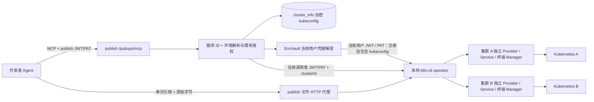

# publish 本地操作器接入

日期：2026-11-13。本页为当前接入方案；早期“每个集群内部署控制器、publish 用 kubeconfig 初始化 ServiceAccount”的方案保留为独立部署参考，不用于这次联调。

## 项目与运行位置

上层唯一开发目录为 `/Users/vincent/IdeaProjects/efficient-platform/publish-devops-api`，采用 Boot 4 / Spring AI 2。旧 `Desktop/codes.nosync/tmp-code/publish-devops-api` 只作历史迁移参考，不再修改。

下层目录为当前 k8s-ctl 项目。统一 `cmd/main.go` 根据 `app.mode` 选择独立使用方式或平台托管入口。在本机或管理网络部署一个操作器，不要求在业务集群部署 k8s-ctl。



## 两类内部请求

1. `POST /api/v1/operator/clusters/configure`：Publish 先完成服务和环境权限检查，再使用当前调用者 JWT/PAT 注册配置。输入为 `clusterId`、`kubeconfig`；旧 `allowedNamespaces` 仅兼容接收并忽略。只返回集群标识，不返回凭据
2. `/clusters/{clusterId}/api/v1/...`：使用同一认证 HTTP 契约，保留真实 UserID。业务资源权限由 Publish 检查，k8s-ctl 负责 Token 有效性、目标隔离和运行实例校验

健康检查为 `GET /api/v1/pub/health`。默认监听回环地址；跨主机传递 kubeconfig 必须经受控 HTTPS。不可把注册入口直接公开给开发者。

配置相同的重复注册复用原 runtimeId 和终端。配置变化时创建新运行实例；旧请求执行完毕后释放旧终端管理器。不同集群分别构造 client-go、kubectl/Helm Runner、上游私有 MCP 执行器、终端 Manager 和文件引用状态。集群目录上限由 `operator.max-clusters` 配置，默认 16；终端上限按各集群配置，示例为 128/每用户 16，仍受现有校验范围限制。

注册请求最多 256 KiB；kubeconfig 最多 128 KiB，仅支持内嵌证书/密钥/token，拒绝外部 CA/证书文件、tokenFile、exec/auth-provider、代理 URL 和 impersonation，包括未选中的上下文。此限制不是文件传输大小限制。Provider 仅存内存；需要 CLI/上游时使用现有 0600 临时文件并清理，不将集群凭据写入数据库或日志。

## 上层第一批能力

publish 已有服务查询、Pod 状态和 install/upgrade/uninstall，本轮不重复注册。新增八个工具：

| 工具 | 下层 HTTP |
| --- | --- |
| `k8sctl-get-service-logs` | `/cluster/pods/logs` |
| `k8sctl-exec-service-command` | `/cluster/pods/exec` |
| `k8sctl-open-service-terminal` | `/cluster/pods/terminals/open` |
| `k8sctl-write-service-terminal` | `/cluster/pods/terminals/write` |
| `k8sctl-read-service-terminal` | `/cluster/pods/terminals/read` |
| `k8sctl-close-service-terminal` | `/cluster/pods/terminals/close` |
| `k8sctl-prepare-service-file-download` | `/cluster/pods/files/prepare-download` |
| `k8sctl-prepare-service-file-upload` | `/cluster/pods/files/prepare-upload` |

表中路径需加 `/clusters/{clusterId}/api/v1`。用户通常只提供 serviceId、env；默认 env=dev，支持 sim/仿真。Namespace、release、标签和集群从现有服务配置及迁移关系解析。多 Pod / 多容器必须选择，不随机执行。文件 URL 指向 publish，不向客户端暴露操作器地址或 kubeconfig。

上层复用现有服务可见范围、日志/终端操作权限、Pod 归属及运行内容授权；生产环境使用既有 MCP 开关。下层继续检查认证、Namespace 格式与目标一致性、资源白名单、写开关、UID 和会话归属，不接受身份 Header 覆盖。

2026-11-13 联调临时放行：`pod-exec.authorization-enabled: false` 跳过 Pod 执行资格策略和静态 grants，不要求 exec-enabled 标签；`shell.interceptor.enabled: false` 跳过命令拦截扩展点。配置默认值为开启目标授权，只有显式关闭才放行，`diagnostics-only` 不允许关闭。Pod 是否存在、容器是否运行、UID 一致性、会话归属、文件引用有效期及完整性始终校验；Kubernetes RBAC 与容器文件系统权限仍由集群执行。后续权限恢复见 [待办](roadmap.md)。

## 启动与配置

直接使用项目唯一配置文件 `configs/config.yaml`，将 `app.mode` 设为 `operator`。本地 GoLand 和容器部署都使用 `server.port: 8901`。同时配置平台 JWT/PAT 公钥和本机已安装的上游 v0.1.2 可执行程序：

```sh
go run ./cmd
```

publish 在应用配置中配置 enabled 和 operator 地址，不再维护 Namespace 名单，也不再生成下层专用 JWT 或控制凭据。Publish 从当前请求上下文取得 JWT/PAT，并将同一个 Bearer Token 用于注册和业务请求。上层配置示例及测试见上层 `docs/k8sctl-integration.md`。

发布库字段 `cluster_info.kubeconfig_ciphertext` 必须保存 EnvVault 密文。当前适配支持原始 kubeconfig YAML 和带 clusterId/group/env/kubeconfig 的旧 JSON 信封；JSON 信封必须与服务解析目标一致。Token 可从个人设置/Redis 读取，但必须与实际 EnvVault 的用户和 PAT 记录匹配。不能因解密失败而回退到本机默认 kubeconfig。

## 生命周期与失败处理

publish 在初始化前校验业务权限。成功配置缓存 30 秒；集群凭据改变后重建；服务 Namespace 不参与集群实例身份，同集群不同 Namespace 共用运行实例。操作器重启导致未注册时，仅重试注册和只读能力查询；exec、write、open、上传与部署均不自动重试。publish/操作器重启后旧句柄失效，返回错误，不能自动迁移到同名 Pod 或其他集群。

当前配置替换可让已开始的旧集群请求完成；凭据紧急撤销需停用入口/停止操作器并撤销 Kubernetes 凭据。配置注册不是完整凭据轮换中心。单进程内存状态不提供 HA，多副本、会话共享、集群卸载 API、空闲集群回收、断点续传与大文件并发治理后续处理。

## 联调约束

本轮用户授权目标为 10121993 / 8824195328 / sim / gdl-dev-lucy / devops-efficient-test1。先记录部署状态、Chart 与持久卷，再验证日志、Shell、终端中断、文件传输，随后测试安装中、安装后、卸载后的行为。不删除 PVC/PV，不拉取新镜像，不在容器安装工具。自动化模拟测试不能替代真实集群结果，报告需明确依赖阻塞及未完成项目。

最新结果见 [2026-11-13 联调报告](testing/publish-local-operator-2026-11-13.md)，其中区分真实集群通过项、失败边界和未完成验收项。
