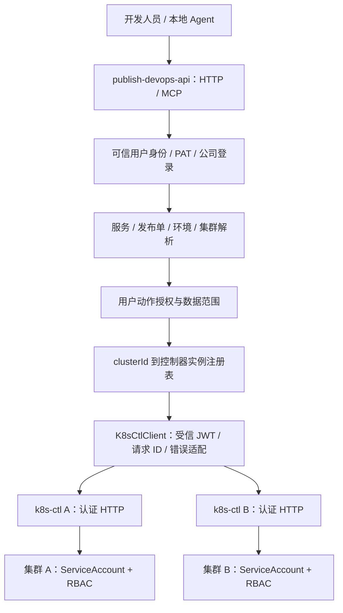

# publish-devops-api 与 k8s-ctl 对接方案

> 2026-11-13 当前实施方案已变更：publish 集中保存加密 kubeconfig，启动本地/管理网络操作器，不在业务集群部署控制器。按集群隔离运行实例，细节见 [本地操作器接入](platform-local-operator.md)。本页集群内 ServiceAccount 部署部分为早期/可选方案。

更新：2026-11-11，分支 `feat-developer-ctl`。定位：publish-devops-api 是面向用户的业务、权限与统一 MCP 入口；k8s-ctl 是各集群的执行控制器。已交付源码分析、完整能力配置、对接实施清单及独立的 [平台部署包](../deployments/platform/README.md)，上层已新增 8 个容器 MCP（k8sctl- 前缀，日志、单次 Shell、持续终端与文件准备）、认证文件流 HTTP、内部目标解析、独立 HTTP 客户端和加密凭据初始化入口，尚未真实部署联调。

## 1. 当前状态与本次调整

此前的只读方案仅做了清单盘点，没有实际关闭代码功能。当前分支保留全部已支持的资源变更、Helm、目录、端口、Shell、终端和文件接口；无需恢复删除的业务代码。

统一使用 [配置示例](../configs/config.example.yaml)，通过同一个 `config.yaml` 的 `app.mode` 选择 operator 或 standalone；Publish 对接使用 operator。HTTP、Kubernetes 写、Pod exec、Shell 等能力按该文件的开关配置，不再维护模式专用配置文件或 `.local` 覆盖文件。保留公司 JWT 验签、平台 PAT 独立验签、用户绑定句柄、独立 Shell 拦截点和 Kubernetes RBAC。没有新增平台角色、create-user-id 或管理员策略。

运行时直接填写 `configs/config.yaml`，部署时将同一文件挂载为 `/app/configs/config.yaml`，再填写可信公钥、实际 issuer/audience、clusterId、Namespace 和网关配置，并保证 `/data` 可写持久化。它没有修改运行中的部署，不能据此认为线上已经放开。当前示例的 issuer、audience 和 key-id 必须由上下层实际签发约定确认。

完整能力指当前已实现的能力，不包括任意 CRD、Secret 通用 CRUD、节点操作或 RBAC 管理。主 MCP 可以关闭，上层只调用下层 HTTP；内部执行用 Kubernetes MCP Server sidecar 是独立组件，仍用于单次 exec。

## 2. 上层源码核对依据

检查的本地项目：`/Users/vincent/Desktop/codes.nosync/tmp-code/publish-devops-api`。这是本地检出的源码，不代表线上版本已经一致。

| 上层现有模块 | 核对结果 | 对接建议 |
| --- | --- | --- |
| `entities/dao/ClusterInfo.java` | 已有 id、group、env、url、token 等字段 | 复用稳定集群 ID；新增独立的 ctlBaseUrl、backendId、信任配置引用，或单独映射表；不要直接改变旧 url/token 语义 |
| `service/k8s/ClusterCache.java` | 通过 group + env 查询并缓存集群信息，来源为 ClusterInfoMapper | 复用业务定位；将最终结果转换为稳定 clusterId，再解析控制器地址；不能把环境名称当作全局唯一集群 ID |
| `service/cluster/NamespaceServiceImpl.java` | 已将服务/发布单、环境、集群、Namespace 关联 | 在业务层解析目标和授权，再调用新执行适配器；兼容现有 LQY 等后端 |
| `service/k8s/impl/PodServiceImpl.java` | 通过 HelmWrapperApi、HttpUtils、OkHttp 调用旧执行后端 | 新建 K8sCtlClient；保留旧接口契约，通过明确后端类型选择逐步迁移 |
| `mcp/*` | 已存在 Spring MCP 工具，包括业务查询、配置保存等 | 复用主 MCP 的注册机制，添加开发环境工具，不让客户端同时连接各下层 MCP |
| `mcp/config/AgentConfig.java` 与部分工具 | 存在固定 agent userId、显式 gxjId 工号入参等历史路径 | 不直接套用为新工具的可信身份来源；接入时核对平台真实认证 context，拒绝用户自报工号覆盖身份 |
| `config/OkHttpConfig.java` | 共享客户端配置 retryOnConnectionFailure(true) | 新建控制器专用客户端，关闭自动重试及不受控重定向，按普通请求与文件流分别设置预算 |

初次核对时没有控制器客户端。本轮已在上层新增 `service/k8sctl`、`mcp/K8sCtlTools` 和可选 transport 身份适配；首批按服务负责人/开发成员限制读取，未把历史工具的自报工号用于新入口。完整说明在上层仓库 `docs/k8s-ctl-integration.md`，配置默认关闭，仍需真实上下层联调。

## 3. 最终调用架构

“挂在下面”是网络服务集成：Java 平台调用 Go 控制器 HTTP，不把 Go 项目当作 Maven 子模块或进程内插件。每个集群部署一个单副本控制器，使用 InCluster 凭据；上层无需持有各集群 kubeconfig。首期可以先从配置维护控制器映射，再接入已有集群表。

| publish-devops-api 负责 | k8s-ctl 负责 |
| --- | --- |
| 用户登录/PAT、权限中心、业务上下文、资源可见范围、统一 MCP/HTTP、操作审计和审批 | 单集群资源/Helm 执行、输入校验、执行边界、状态与错误、终端/文件生命周期 |
| 集群目录、选择与地址映射、平台侧会话/文件句柄 | clusterId/runtimeId/能力报告、Pod UID 校验、用户归属句柄 |
| 决定用户是否可以执行动作及访问哪些目标 | 验证调用来自受信入口、校验实际参数、保留 RBAC 和拦截扩展点 |

控制器仅向平台网络开放。若仍向开发人员直接开放下层 MCP/HTTP，就可能绕过上层用户权限；所以权限上移时必须同步收敛网络入口，不能仅依赖“客户端不展示该地址”。

## 4. 接入需要完成的工作

### A. 集群与控制器注册

上层新增 BackendDirectory / Registry：记录 clusterId、backendId、ctlBaseUrl、enabled、信任配置引用。地址只能来自受控注册信息，不接受用户传入任意 URL。连接时查询 `GET /api/v1/operator/capabilities`，核对 clusterId、apiVersion、runtimeId、版本及实际能力；不匹配拒绝操作，不默默回退到别的集群。

下层已有 cluster.id，catalog.cluster 与之显式配置一致。首期一个集群一个执行实例，SQLite、端口台账各自持久化；不把现有单副本直接扩到多副本。

### B. 可信用户身份传递

上层验证用户 JWT/PAT、执行授权后，透传当前调用者的同一个 Bearer。k8s-ctl 使用公司 JWT 公钥或独立的 PAT 公钥进行本地验签，不连接 Setting Redis。Publish 不签发短期内部 JWT，k8s-ctl 不维护独立 PAT 数据库，也不接受 X-User-Id 覆盖身份。下层支持的用户 claim 使用 `staffuserid`，并分别校验两类 Token 的 exp、issuer、audience 和配置的 kid。

必须保留真实 UserID，否则终端和文件引用归属会退化成所有人共用一个账号。不能仅通过 X-User-Id 或 MCP 的 gxjId 参数宣称用户身份。操作器注册和业务请求使用同一认证链路，Publish 的业务权限与 k8s-ctl 的目标、会话和 Kubernetes RBAC 校验分别执行。

下层公司 JWT 验签支持已实现；动态多公钥轮换、令牌交换服务和平台专用细粒度授权令牌尚未实现。

### C. HTTP 执行客户端与错误契约

建立能力分类的 K8sCtlClient，例如 ResourceClient、WorkloadClient、HelmClient、TerminalClient、FileClient、CatalogClient，底层共用连接、认证和错误适配。以 [OpenAPI](http-openapi.json) 与 [覆盖矩阵](http-mcp-coverage.md) 为契约，不重新实现 Kubernetes 业务。

- 先接查询，再接写操作；主 MCP 已有 57 个工具的 HTTP 对应，不需要额外代理下层 JSON-RPC。
- 上层接收 serviceId/env 等业务参数，解析为已授权的 clusterId、Namespace、资源名和动作，随后调用下层。不能只校验服务 ID，再原样放行请求里另一个 Namespace 或 Pod 名称。
- HTTP 状态与 code/msg/data 都检查，保留 data.reason 和执行结果。不要把所有错误改成普通失败或 HTTP 200 成功。
- 保留 Outcome、TimedOut、UpstreamError；execution_unknown 和 Catalog 的结果未知必须提示回查实际状态。写请求禁止自动重试；有明确 requestId/部署恢复契约的 Catalog 另按其规则处理。
- X-Request-Id 全链路透传；平台写审计关联用户、集群、目标、动作、授权结果与执行结果，避免记录原始 token、文件内容或凭据。
- JSON、普通查询、长变更和文件流分开预算；上层取消应关闭下游调用。代理路径允许包含 /k8sctl，不能重复加前缀。

### D. 上层权限边界

上层对 HTTP 与 MCP 使用同一业务授权入口。列表/搜索/统计先确定可见集群与 Namespace；分页和总数不能泄露无权资源。单资源 YAML、日志等也在读取前鉴权。

通用 apply 包含多个对象时，逐对象校验 Namespace/类型/目标，禁止用 YAML 夹带另一个服务的资源。Helm 可能影响多资源，需要明确 chart 来源、release 范围和变更权限；只授权一个 release 名称不足以证明模板内容合法。旧后端切换时不要扩大用户权限。

下层 Authorizer 仍保留扩展接口但不新增用户策略；Namespace 格式与请求目标一致性、资源白名单、Pod 执行资格和 Kubernetes RBAC 属于执行边界；静态 Namespace 名单已取消，用户范围由平台服务权限决定。若希望调整这些范围，应分别明确需求，不能用“权限放上层”自动解释为支持任意 CRD、Secret CRUD 或 privileged Pod exec。

### E. 对外 MCP 串联

平台主 MCP 增加开发环境能力族，在工具内部执行身份 → 业务定位 → 授权 → 解析控制器 → HTTP 调用。面向业务场景可以接受 serviceId/env，在通用集群工具中明确 clusterId，缺少目标时提示用户，不推断或随机选集群。异步处理需显式传递可信身份，不能依赖线程切换后仍存在的 ThreadLocal。

不必一次暴露全部 57 个工具。第一批资源列表、详情/YAML、事件/日志；第二批扩缩容、重启、apply 和 Helm；第三批终端、文件和标准服务。下层能力开启不等于上层工具自动对所有用户开放。

### F. 持续终端与文件

平台存储/封装受控句柄，绑定 userId、clusterId、backendId、runtimeId、下层 sessionId/transferId、目标 Pod UID 与有效期。每次 open/write/read/close、prepare/传输均重新做归属及动作检查；实例重启后令牌失效，不迁移旧会话。

终端通过既有 open/write/read/close HTTP 实现，输出 base64、cursor、lostBytes、过期和中断语义透传。若平台现有 WebSocket UI 要复用，新增 WebSocket 到这些接口的适配，不把旧 Helm WebSocket 协议直接套到新控制器。

MCP 准备文件后返回平台 URL，不返回下层私网 URL。平台流式代理，保留上传 Content-Length；不把 multipart 原样转给只收 application/octet-stream 的下层。保留单次引用、大小/SHA-256、取消和断流语义，不全量读入 String/byte[]，不自动重试传输。下载发送部分数据后失败应中断，不追加 JSON。容量/断点续传仍后续处理。

### G. 标准目录与后台任务归属

Catalog 可继续在下层存储模板、实例修订、部署与端口记录，上层保存业务关联和授权；不要把下层 instanceId 等同于上层 serviceId。建立关联：(clusterId, catalogInstanceId, platformServiceId, userId)。上层服务部署与新标准目录不要同时协调同一组资源。

沙箱到期回收仍由下层定时任务执行，需要与平台确定租期授权和审计，避免误以为“所有动作每次都经上层 HTTP 鉴权”。端口分配和部署恢复依赖下层单实例台账，不能由上层直接覆盖 SQLite 状态。

## 5. 建议实施顺序与验收

| 阶段 | 工作 | 验收 |
| --- | --- | --- |
| 0 下层准备（已交付） | 完整能力示例、独立平台部署包、分组 RBAC、公钥准备与 HTTP 检查脚本；保留认证与执行边界 | 基础/完整清单本地渲染及配置契约测试；真实部署待执行，见 [验证记录](testing/platform-package-2026-11-11.md) |
| 1 最小上下层链路 | 集群映射、可信身份、独立 HTTP Client、能力探测、资源/日志查询 | 两个用户、两个集群、同名资源不串；错误 token/audience 和伪造工号拒绝 |
| 2 权限与写能力 | 上层动作/数据范围、共享 MCP/HTTP 用例、apply/scale/restart/Helm | 未授权请求不触达下层；变更取消/结果未知不自动重试；兼容旧后端 |
| 3 有状态能力 | 终端句柄及文件代理 | 跨用户拒绝、Pod 替换、Ctrl+C、重启失效、二进制/零字节、截断/取消、哈希与前缀通过 |
| 4 标准服务整合 | 实例/服务映射、端口/配置台账、租期回收与审计 | 部署、就绪、协议验证、删除和端口释放闭环；保留 PVC 行为明确 |
| 5 交付与容量 | 灰度迁移、监控、备份恢复、并发与大文件验证 | 正式入口端到端报告；控制器单副本限制和容量明确 |

真实联调先使用隔离 Namespace 和已有缓存镜像，不拉取新镜像、不修改现有业务数据；本轮没有访问集群。上层项目具体认证实现位于依赖模块的部分仍需确认，不能以本次源码浏览替代完整权限审计。

## 6. 待双方确认的具体信息

- 上层 HTTP/MCP 入口均从当前请求上下文取得 JWT/PAT，并将同一个 Bearer Token 传递给操作器；不再引入内部 JWT 签发能力。
- ClusterInfo.id、Helm Wrapper 中 cluster 参数和实际集群的一一对应关系；控制器地址维护位置。
- 公司 JWT 的算法、issuer/audience/kid、公钥管理和用户 claim；不在文档填写真实 token。
- 第一批需要开放的动作和业务对象：以服务授权还是允许 Namespace 级通用资源操作。
- 是否第一期就整合下层 Catalog/端口，还是先只接资源、日志与执行能力；下层示例全开但上层可分阶段暴露。

## 7. 本轮验证结果

`go test ./... -count=1`、`go vet ./...` 与 `git diff --check` 全部通过；完整能力 YAML 的开关、集群 ID、Namespace 范围一致性及本文件链接检查通过。本轮未修改 Go 源码，不涉及 gofmt 变更；没有修改上层项目、真实密钥或实际运行配置，没有执行集群部署或上下层真实联调。配置包含待挂载公钥路径和环境占位值，校验通过不代表无需准备即可启动。

## 8. 上层首批实现（2026-11-11）

按范围收敛，publish 对外新增日志、单次 Shell、终端 open/write/read/close、文件上传/下载准备共 8 个 `k8sctl-` 工具；原先新增的目标解析、Pod 列表两个 MCP 已撤下，服务/Pod 查询复用既有发布工具，目标解析与候选筛选保留为内部逻辑。用户传 serviceId 和可选环境（省略默认 dev），平台复用服务及迁移后的集群记录，取得 Namespace/发布名，再按服务标签发现 Pod 和容器。多候选返回选择提示，不查询同 Namespace 下无关服务日志。上层对 HTTP 与工具错误保留原因，不自动重试或跟随重定向。

按用户确认，kubeconfig 由 publish 管理：集群表 `cluster_info` 新增 `kubeconfig_ciphertext`，调用 EnvVault 现有 crypto encrypt/decrypt API，以固定服务身份 self 策略加密。普通集群 DTO 不加载此字段。管理员显式保存和初始化，publish 仅在初始化时解密到 0600 临时文件，用参数数组执行 kubectl 应用受控部署包，结束清理；控制器日常使用 InCluster ServiceAccount，业务请求不传 kubeconfig。本轮没有给下层加明文配置接口或数据库 Provider。

本轮容器工具和文件流代理已完成源码与本地测试，通用资源变更和 Catalog 未额外注册为上层新工具；数据库 DDL、真实 EnvVault/身份、镜像部署及实际日志验收均待执行。上层源码、配置、SQL 和测试交付在 publish 仓库，保留其中原有无关改动。

本轮聚焦日志、单次 Shell、持续终端和容器文件上传下载的上层 MCP/HTTP 适配；Namespace、Deployment、Pod 基础管理沿用现有发布能力，不重复建设。本轮容器工具统一使用 k8sctl- 前缀。publish 既有页面日志和 Shell WebSocket 链路已存在，本轮补齐 Agent 的调用链，不重写下层执行内核。工具列表、MCP 参数示例、HTTP curl 测试与边界见 publish 仓库 docs/k8s-ctl-integration.md。

终端和文件引用绑定真实用户、服务部署目标、Pod UID、控制器 runtimeId 和地址；后续每次操作重新校验服务访问，跨用户或 Pod 替换拒绝。文件使用 publish 的 POST `/api/v1/k8s-ctl/files/{transferId}/download|upload`，采用有限缓冲、不自动重试、不信任下层文件 URL；上传保留 Content-Length 并核对 SHA-256/大小回执。终端保留 cursor/base64/lostBytes 和 TTY 控制字符，不以传参测试代替真实 TTY 中断验收。publish 需配置外部 public-base-url，重启后刷新原 MCP 工具列表；下层容器能力/RBAC 也需显式开启。引用为进程内状态，当前单副本/粘性路由，真实环境联调待执行。
